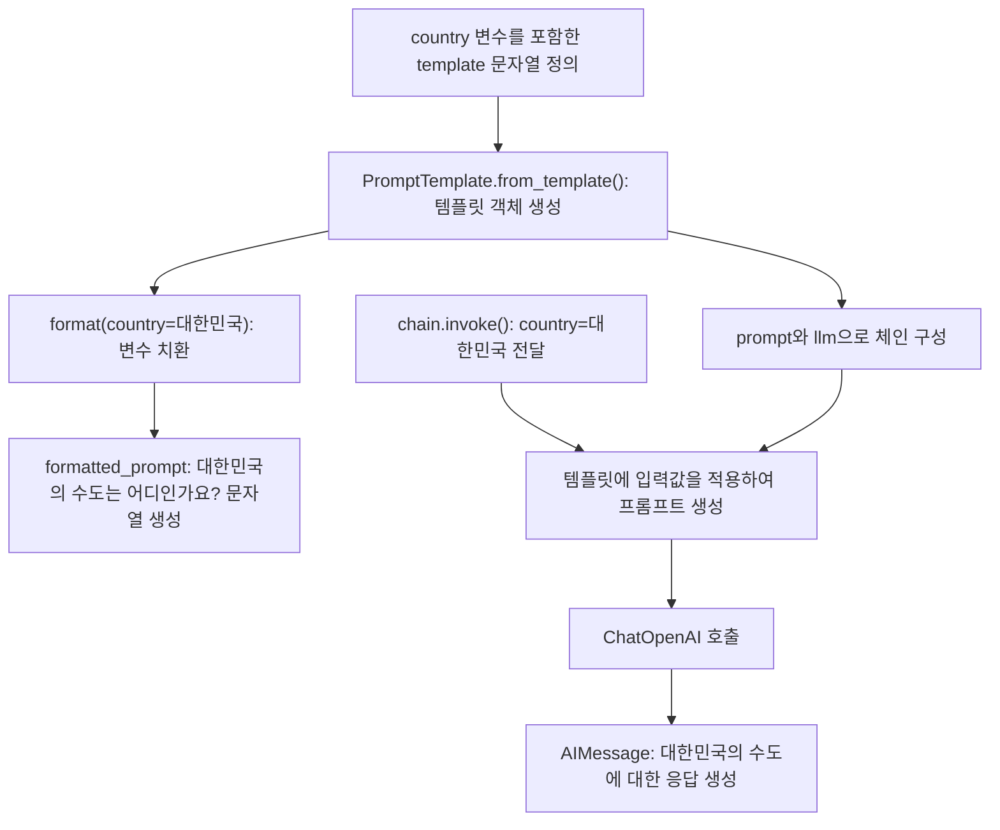
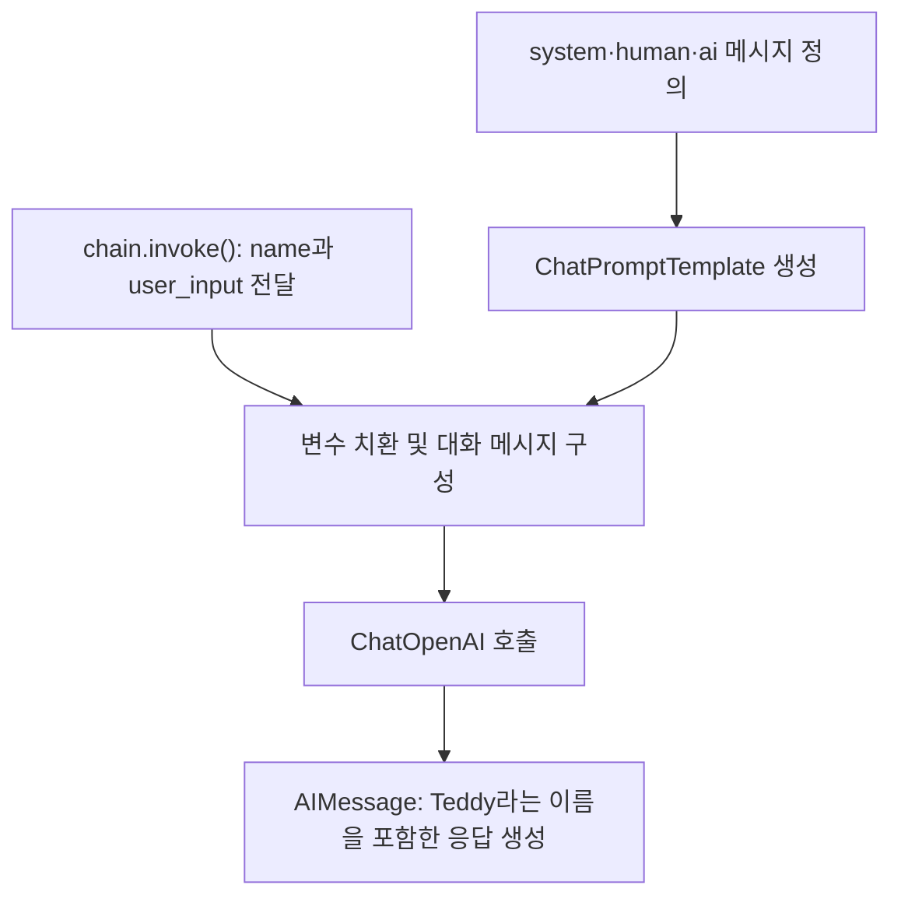
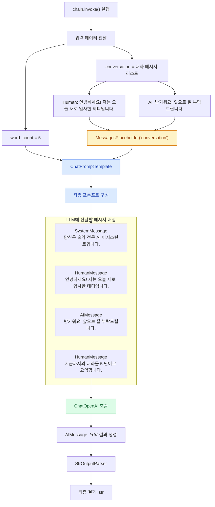
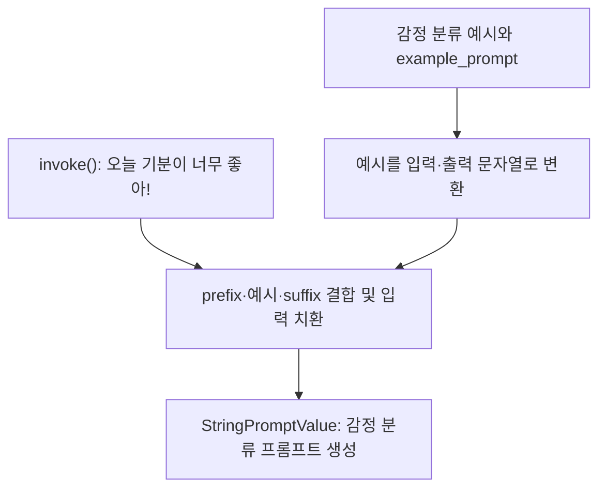
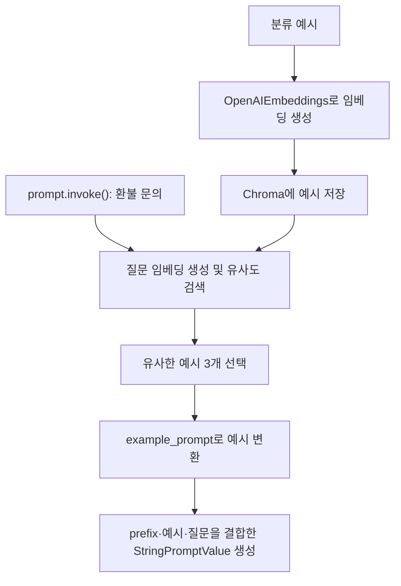
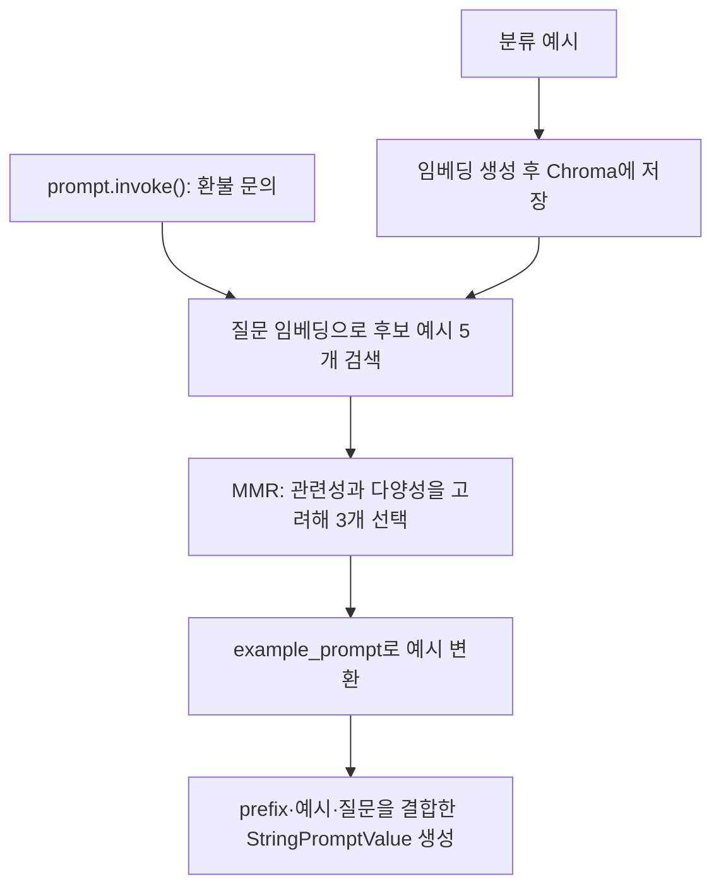
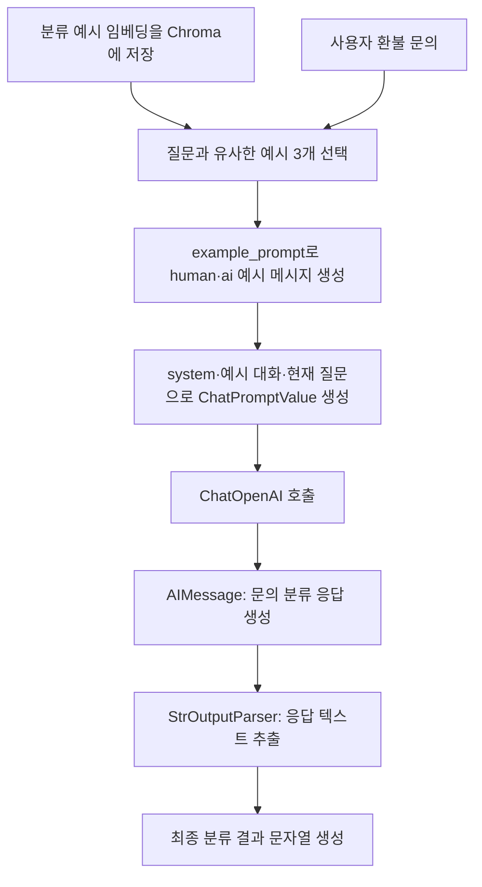

# Chapter 05. 프롬프트

## 프롬프트
- 프롬프트 단계는 리트리버(retriever)에서 검색된 문서들을 바탕으로 언어 모델이 사용할 질문이나 명령을 생성하는 과정이다.

## 프롬프트 템플릿
- AI 모델과의 상호작용을 표준화하고 효율적으로 만들어 주는 구조화된 텍스트 형식이다.
- 사전에 정의된 이 템플릿은 모델에게 전달할 지시 사항, 컨텍스트, 제약 조건 등을 담고 있으며, 변수를 포함하여 다양한 입력값에 대해 일관된 출력을 생성한다.
- 프롬프트 템플릿의 구조는 지시 사항(instruction), 사용자 입력 질문(Question), 검색된 정보인 문맥(Context)으로 구성된다.
- from_template() 메서드를 사용하여 PromptTemplate 객체를 생성하는 방법과 PromptTemplate 객체 생성과 동시에 프롬프트를 생성하는 방법이 있다.

## 프롬프트 템플릿 생성 및 사용
```python
from langchain_core.prompts import PromptTemplate
from langchain_openai import ChatOpenAI

# 1. 템플릿 정의 및 객체 생성
template = "{country}의 수도는 어디인가요?"
prompt = PromptTemplate.from_template(template)

# 2. 변수 치환 결과 확인
formatted_prompt = prompt.format(country="대한민국")
print(formatted_prompt)
# 출력 - '대한민국의 수도는 어디인가요?'

# 3. 모델과 체인 연결
llm = ChatOpenAI(model="gpt-4o-mini", temperature=0)
chain = prompt | llm

# 4. 실행
result = chain.invoke({"country": "대한민국"})
print(result.content)
# 출력 - '대한민국의 수도는 서울입니다.'
```

<details>
<summary>위 예시 코드 흐름도 보기</summary>



</details>

- 프롬프트 템플릿의 변수는 중괄호("{}")로 감싸서 표현한다.
- from_template() 메서드를 이용하여 PromptTemplate 객체를 생성한다.
- 작업 중간에 변수 치환 결과를 확인하고 싶을 때 format() 메서드를 사용한다. 반환된 문자열은 formatted_prompt에 저장하여 prompt를 템플릿 객체로 유지한다.
- 템플릿을 모델과 연결하고 invoke()에 입력값을 전달하여 응답을 생성한다.

## 또 다른 생성 방식
```python
template = "{country}의 수도는 어디인가요?" # template 정의

# PromptTemplate 객체를 활용하여 prompt_template 생성
prompt = PromptTemplate(
    template=template,
    input_variables=["country"],
)
```
- 템플릿 문자열을 정의한 후 객체 생성 시 template과 input_variables를 직접 지정한다.
- input_variables에 country 변수를 넣었기 때문에 나중에 이 변수가 제대로 전달되지 않으면 오류를 발생시켜 누락이나 잘못된 이름으로 전달되는 실수를 방지한다.

### partial_variables
```python
template = "{country1}과 {country2}의 수도는 각각 어디인가요?"

prompt = PromptTemplate(
    template=template,
    input_variables=["country1"],
    partial_variables={
        "country2": "미국" 
    }
)

prompt.partial(country2="캐나다") # 이미 생성된 프롬프트에 바인딩
```

- 보통 두 개 이상의 변수를 처리하는 경우 일부 변수를 미리 확정할 필요가 있을 때 유용하다.
- 특정 변수를 임의의 값으로 미리 바인딩(고정)하기 위함이다.
- dictionary 형태로 전달한다.
- 이미 생성된 프롬프트에는 partial() 메서드를 사용해 바인딩할 수 있다.
- 위와 같이 바인딩된 값도 invoke() 시 새로운 값을 넣어주면 대체될 수 있다.

## 부분 변수
```python
# 오늘 날짜를 가져오는 함수 선언
def get_today():
    return datetime.now().strftime("%B %d")

prompt = PromptTemplate(
    template="오늘의 날짜는 {today}입니다. 오늘이 생일인 유명인 {n}명을 나열해 주세요. 생년월일을 표기해 주세요.",
    input_variables=["n"],
    partial_variables={
        "today": get_today # dictionary 형태로 전달
    }
)
```
- 주로 함수를 사용하여 프롬프트의 일부를 미리 설정한다.
- 날짜나 시간처럼 항상 동일한 방식으로 처리해야 하는 변수가 있을 때 유용하다.

## YAML 파일로부터 프롬프트 템플릿 로드
```yaml
_type: "prompt"
template: "{fruit}의 색깔이 뭐야?"
input_variables: ["fruit"]
```
- 프롬프트 템플릿을 사용할 때 프롬프트가 길어지면 소스코드 내의 문자열이 너무 길어져 관리하기 힘들 경우 YAML 파일에 별도로 저장하고 쉽게 관리할 수 있다.

```python
from langchain_core.prompts import load_prompt

prompt = load_prompt("prompt/fruit_color.yaml", encoding="utf-8")
```
- langchain_core.prompts 모듈의 load_prompt() 함수를 통해 로드한다.


## ChatPromptTemplate
```python
from langchain_core.prompts import ChatPromptTemplate

chat_template = ChatPromptTemplate.from_messages(
    [
        ("system", "당신은 친절한 AI 어시스턴트입니다. 당신의 이름은 {name}입니다."),
        ("human", "반가워요!"),
        ("ai", "안녕하세요! 무엇을 도와드릴까요?"),
        ("human", "{user_input}"),
    ]
)

llm = ChatOpenAI()

chain = chat_template | llm

print(chain.invoke({"name": "Teddy", "user_input": "당신의 이름은 무엇입니까?"}).content)
# 출력 - '제 이름은 Teddy입니다. 저랑 함께 이야기 나누어 보세요!'
```

<details>
<summary>위 예시 코드 흐름도 보기</summary>



</details>

- ChatPromptTemplate을 사용하면 프롬프트 템플릿보다 더 자연스럽고 좋은 답변을 얻을 수 있다.
- AI와 사용자가 대화를 주고받는 형식으로 프롬프트를 구성하므로 더 유연하고 자연스러운 결과를 내놓는다.
- (role, message) 형태의 tuple로 구성하여 리스트로 생성할 수 있다.
- 역할(role)에는 system, human, ai가 있으며 메시지를 구성할 때 이 셋 중 하나는 반드시 넣어야 한다.


## MessagesPlaceholder
```python
chat_prompt = ChatPromptTemplate.from_messages(
    [
        (
            "system",
            "당신은 요약 전문 AI 어시스턴트입니다. 당신의 임무는 주요 키워드로 대화를 요약하는 것입니다.",
        ),
        MessagesPlaceholder(variable_name="conversation"),
        ("human", "지금까지의 대화를 {word_count} 단어로 요약합니다."),
    ]
)

llm = ChatOpenAI()

chain = chat_prompt | llm | StrOutputParser()

chain.invoke(
    {
        "word_count": 5,
        "conversation": [
            (
                "human",
                "안녕하세요! 저는 오늘 새로 입사한 테디입니다. 만나서 반갑습니다.",
            ),
            ("ai", "반가워요! 앞으로 잘 부탁드립니다."),
        ]
    }
)
```
<details>
<summary>위 예시 코드 흐름도 보기</summary>



</details>

- 대화에서 아직 확정된 메시지는 아니지만 나중에 채워질 메시지를 채우기 위해 임시로 확보한 자리이다.
- 모든 대화 내용이 확정되기 전이므로 MessagesPlaceholder에 저장해 두었다가 나중에 대화 기록을 분석 및 다른 질문에 활용할 수 있다.
- 주로 멀티턴 대화에서 이전 대화 내용을 LLM의 프롬프트에 삽입하기 위해 사용한다.
- 직접 저장하는 것은 아니다. 외부에서 관리하는(memory, db 등) 대화 내용을 MessagesPlaceholder를 통해 전달한다.


## 퓨샷 프롬프트 템플릿
```python
from langchain_core.prompts import (
    FewShotPromptTemplate,
    PromptTemplate,
)

# 1. LLM에 제공할 예시 데이터
examples = [
    {"input": "오늘 정말 행복해.", "output": "긍정"},
    {"input": "너무 화가 나.", "output": "부정"},
    {"input": "정말 즐거운 하루였어.", "output": "긍정"},
]

# 2. 예시 하나를 표현할 템플릿
example_prompt = PromptTemplate.from_template(
    "입력: {input}\n출력: {output}"
)

# 3. Few-Shot 프롬프트 생성
few_shot_prompt = FewShotPromptTemplate(
    examples=examples,
    example_prompt=example_prompt,
    prefix="다음 문장의 감정을 긍정 또는 부정으로 분류하세요.",
    suffix="입력: {input}\n출력:",
    input_variables=["input"],
)

# 4. 실제 질문 전달
result = few_shot_prompt.invoke({
    "input": "오늘 기분이 너무 좋아!"
})

print(result.to_string())
```

<details>
<summary>위 예시 코드 흐름도 보기</summary>



</details>

- 복잡한 문맥이나 질문에 대한 답변을 처리할 때 효과적이다.
- 기본적으로 원샷(One-shot)과 퓨샷(Few-shot)을 포함한다.
- 원샷은 하나의 답변 예시를, 퓨샷은 두 개 이상의 예시를 제공하는 방식이다.


## 예제 선택기(ExampleSelector)
- 질문과 유사한 예시만 선택해 프롬프트에 넣는 방식이다.

### SemanticSimilarityExampleSelector
```python
from langchain_core.example_selectors import SemanticSimilarityExampleSelector
from langchain_core.prompts import FewShotPromptTemplate, PromptTemplate
from langchain_openai import OpenAIEmbeddings
from langchain_chroma import Chroma

# 예시 데이터
examples = [
    {"input": "결제 취소하고 싶어요.", "output": "환불"},
    {"input": "환불해주세요.", "output": "환불"},
    {"input": "돈을 돌려받고 싶어요.", "output": "환불"},
    {"input": "상품을 교환하고 싶어요.", "output": "교환"},
    {"input": "배송이 언제 되나요?", "output": "배송"},
]

# 예시 프롬프트
example_prompt = PromptTemplate.from_template(
    "입력: {input}\n출력: {output}"
)

# 유사도 기반 예제 선택기
selector = SemanticSimilarityExampleSelector.from_examples(
    examples=examples,
    embeddings=OpenAIEmbeddings(model="text-embedding-3-small"),
    vectorstore_cls=Chroma,
    k=3,
    input_keys=["input"],
)

# Few-Shot 프롬프트
prompt = FewShotPromptTemplate(
    example_selector=selector,
    example_prompt=example_prompt,
    prefix="사용자 문의를 환불, 교환, 배송 중 하나로 분류하세요.",
    suffix="입력: {input}\n출력:",
    input_variables=["input"],
)

# 실행
result = prompt.invoke({
    "input": "결제를 취소하고 환불받고 싶어요."
})

print(result.to_string())
```

<details>
<summary>위 예시 코드 흐름도 보기</summary>



</details>

- 입력된 질문과 의미가 가장 유사한 예시를 선택하는 방식이다.
- 예제를 저장해 두고 사용자의 질문이 들어오면 저장된 예시와 유사도 계산을 통해 가장 적합한 예제를 선택한다.
- k라는 매개변수를 통해 선택할 예시의 개수를 지정한다.

### MaxMarginalRelevanceExampleSelector
```python
from langchain_core.example_selectors import MaxMarginalRelevanceExampleSelector
from langchain_core.prompts import FewShotPromptTemplate, PromptTemplate
from langchain_openai import OpenAIEmbeddings
from langchain_chroma import Chroma

# 예시 데이터
examples = [
    {"input": "결제 취소하고 싶어요.", "output": "환불"},
    {"input": "환불해주세요.", "output": "환불"},
    {"input": "돈을 돌려받고 싶어요.", "output": "환불"},
    {"input": "상품을 교환하고 싶어요.", "output": "교환"},
    {"input": "배송이 언제 되나요?", "output": "배송"},
]

# 예시 프롬프트
example_prompt = PromptTemplate.from_template(
    "입력: {input}\n출력: {output}"
)

# MMR 기반 예제 선택기
selector = MaxMarginalRelevanceExampleSelector.from_examples(
    examples=examples,
    embeddings=OpenAIEmbeddings(model="text-embedding-3-small"),
    vectorstore_cls=Chroma,
    k=3,
    fetch_k=5,
    input_keys=["input"],
    vectorstore_kwargs={"lambda_mult": 0.5},
)

# Few-Shot 프롬프트
prompt = FewShotPromptTemplate(
    example_selector=selector,
    example_prompt=example_prompt,
    prefix="사용자 문의를 환불, 교환, 배송 중 하나로 분류하세요.",
    suffix="입력: {input}\n출력:",
    input_variables=["input"],
)

# 실행
result = prompt.invoke({
    "input": "결제를 취소하고 환불받고 싶어요."
})

print(result.to_string())
```

<details>
<summary>위 예시 코드 흐름도 보기</summary>



</details>

- 유사도뿐만 아니라 예시의 다양성까지 고려하여 선택하는 방식이다.
- **MMR 알고리즘**
    - 정보 검색과 문서 요약을 할 때, 다양성과 관련성을 모두 고려하여 결과를 선택하는 방법이다.
    - 위 알고리즘의 목표는 비슷한 내용이 반복되지 않도록 하면서도(다양성) 사용자가 찾고 있는 질문과 가장 잘 맞는(관련성) 정보를 제공하는 것이다.
    - **관련성(relevance)**: 사용자가 입력한 검색어나 주제와 문서가 얼마나 잘 맞는지를 평가하는 기준이다.
    - **다양성(diversity)**: 이미 선택된 문서와 다른 새로운 문서 간의 유사성을 계산하여 비슷한 내용의 문서는 다시 선택되지 않도록 한다.

## FewShotChatMessagePromptTemplate
```python
from langchain_core.example_selectors import SemanticSimilarityExampleSelector
from langchain_core.prompts import (
    ChatPromptTemplate,
    FewShotChatMessagePromptTemplate,
)
from langchain_openai import OpenAIEmbeddings, ChatOpenAI
from langchain_chroma import Chroma
from langchain_core.output_parsers import StrOutputParser

# 1. Few-Shot 예시 데이터
examples = [
    {"input": "결제 취소하고 싶어요.", "output": "환불"},
    {"input": "환불해주세요.", "output": "환불"},
    {"input": "돈을 돌려받고 싶어요.", "output": "환불"},
    {"input": "상품을 교환하고 싶어요.", "output": "교환"},
    {"input": "배송이 언제 되나요?", "output": "배송"},
]

# 2. 예시 메시지 템플릿
example_prompt = ChatPromptTemplate.from_messages([
    ("human", "{input}"),
    ("ai", "{output}"),
])

# 3. 유사도 기반 예제 선택기 생성
example_selector = SemanticSimilarityExampleSelector.from_examples(
    examples=examples,
    embeddings=OpenAIEmbeddings(model="text-embedding-3-small"),
    vectorstore_cls=Chroma,
    k=3,
    input_keys=["input"],
)

# 4. Few-Shot ChatMessage 템플릿
few_shot_prompt = FewShotChatMessagePromptTemplate(
    example_selector=example_selector,
    example_prompt=example_prompt,
)

# 5. 최종 ChatPromptTemplate 구성
chat_prompt = ChatPromptTemplate.from_messages([
    ("system", "사용자 문의를 환불, 교환, 배송 중 하나로 분류하세요."),
    few_shot_prompt,
    ("human", "{input}"),
])

# 6. 실제 입력
question = "결제를 취소하고 환불받고 싶어요."

# 7. 유사도 기반으로 선택된 예시 확인
selected_examples = example_selector.select_examples({
    "input": question
})

print("=== 선택된 예시 ===")
for example in selected_examples:
    print(example)

# 8. 최종 프롬프트 확인
result = chat_prompt.invoke({"input": question})

print("\n=== 최종 프롬프트 ===")
for message in result.to_messages():
    print(type(message).__name__, ":", message.content)

# 9. LLM 실행
llm = ChatOpenAI(model="gpt-4o-mini", temperature=0)

chain = chat_prompt | llm | StrOutputParser()

response = chain.invoke({"input": question})

print("\n=== LLM 응답 ===")
print(response)
```

<details>
<summary>위 예시 코드 흐름도 보기</summary>



</details>


- FewShotPromptTemplate과 매우 비슷하지만, ChatMessage라는 요소가 추가된다.
- ChatMessagePromptTemplate과 같이 지시 사항(instruction), 입력(input), 답변(answer)으로 구성된다.
- 선택된 예제를 Chat Model에게 적합한 메시지 형태로 만들어 준다.

## LangChain Hub에서 프롬프트 공유하기
- LangChain Hub(LangSmith Hub)는 다른 사람이 만든 프롬프트를 가져다 쓰거나 내 프롬프트를 올려 공유할 수 있는 저장소이다.
- 프롬프트를 pull/push할 때 `langchainhub` 패키지가 필요하다. (`pip install langchainhub`)
- 프롬프트 push, 비공개 프롬프트 pull 시에는 LangSmith API Key가 필요하다. (`LANGCHAIN_API_KEY` 또는 `LANGSMITH_API_KEY` 환경 변수)

### 프롬프트 pull하여 사용하기
```python
from langchain import hub
from langchain_openai import ChatOpenAI
from langchain_core.output_parsers import StrOutputParser

# 1. Hub에서 프롬프트 가져오기 ("소유자/프롬프트이름")
prompt = hub.pull("rlm/rag-prompt")

# 2. 프롬프트 구조 확인
print(prompt.input_variables)  # ['context', 'question']
print(prompt.messages[0].prompt.template)

# 3. 체인에 연결하여 사용
llm = ChatOpenAI(model="gpt-4o-mini", temperature=0)
chain = prompt | llm | StrOutputParser()

response = chain.invoke({
    "context": "테디노트는 RAG 강의를 제공하는 채널입니다.",
    "question": "테디노트는 어떤 채널인가요?",
})
print(response)
```
- `hub.pull("소유자/프롬프트이름")`으로 공개된 프롬프트를 가져온다. 가져온 결과는 PromptTemplate 또는 ChatPromptTemplate 객체이다.
- `rlm/rag-prompt`는 RAG에서 많이 쓰는 대표적인 공개 프롬프트로, `context`와 `question` 두 변수를 받는다.
- 가져온 프롬프트는 직접 만든 프롬프트와 동일하게 `prompt | llm` 형태로 체인에 연결할 수 있다.
- 특정 버전을 고정하고 싶다면 `hub.pull("rlm/rag-prompt:커밋해시")`처럼 커밋 해시를 붙인다.
- 사용 전에 `input_variables`와 템플릿을 확인하여 어떤 변수를 넘겨야 하는지 반드시 확인한다.

### 내 프롬프트 push하여 공유하기
```python
import os
from langchain import hub
from langchain_core.prompts import ChatPromptTemplate

# 1. LangSmith API Key 설정
os.environ["LANGCHAIN_API_KEY"] = "<YOUR_LANGSMITH_API_KEY>"

# 2. 공유할 프롬프트 작성
prompt = ChatPromptTemplate.from_messages([
    ("system", "당신은 문서 기반 질의응답 AI 어시스턴트입니다. 주어진 context 안에서만 답변하세요."),
    ("human", "#Context:\n{context}\n\n#Question:\n{question}"),
])

# 3. Hub에 업로드 ("내 핸들/프롬프트이름")
url = hub.push(
    "my-handle/my-rag-prompt",
    prompt,
    new_repo_is_public=False,  # 비공개로 생성 (공유하려면 True)
    new_repo_description="context 기반 RAG 질의응답 프롬프트",
)
print(url)  # 업로드된 프롬프트 주소
```
- `hub.push("내 핸들/프롬프트이름", 프롬프트객체)`로 업로드한다. 성공하면 Hub의 프롬프트 URL을 반환한다.
- 내 핸들(handle)은 LangSmith에서 설정한 사용자 이름이며, 처음 push하려면 핸들을 먼저 만들어야 한다.
- 같은 이름으로 다시 push하면 새 커밋(버전)이 추가되어 변경 이력이 관리된다.
- `new_repo_is_public`: 새로 만드는 저장소의 공개 여부이다. 실수로 공개되지 않도록 기본은 비공개(False)로 두고 확인 후 공개하는 것을 권장한다.
