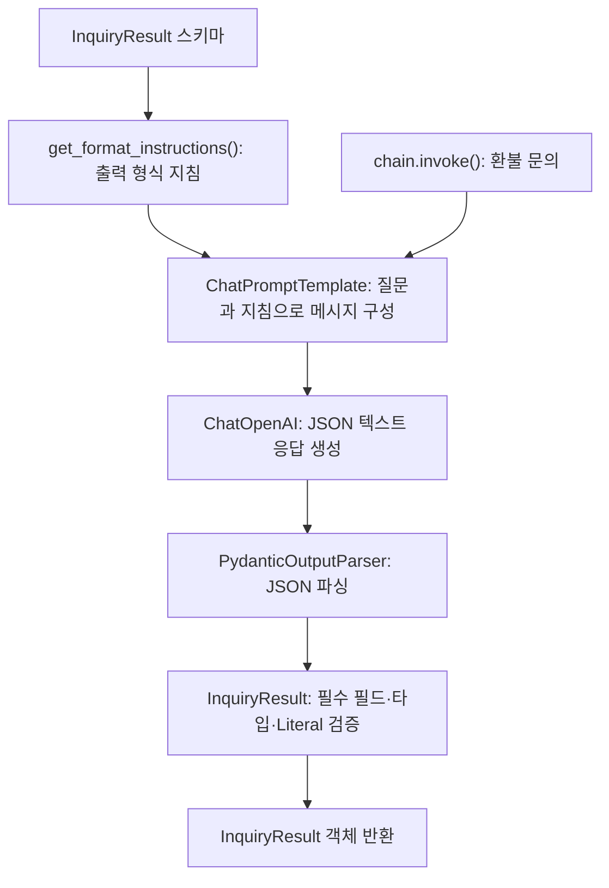
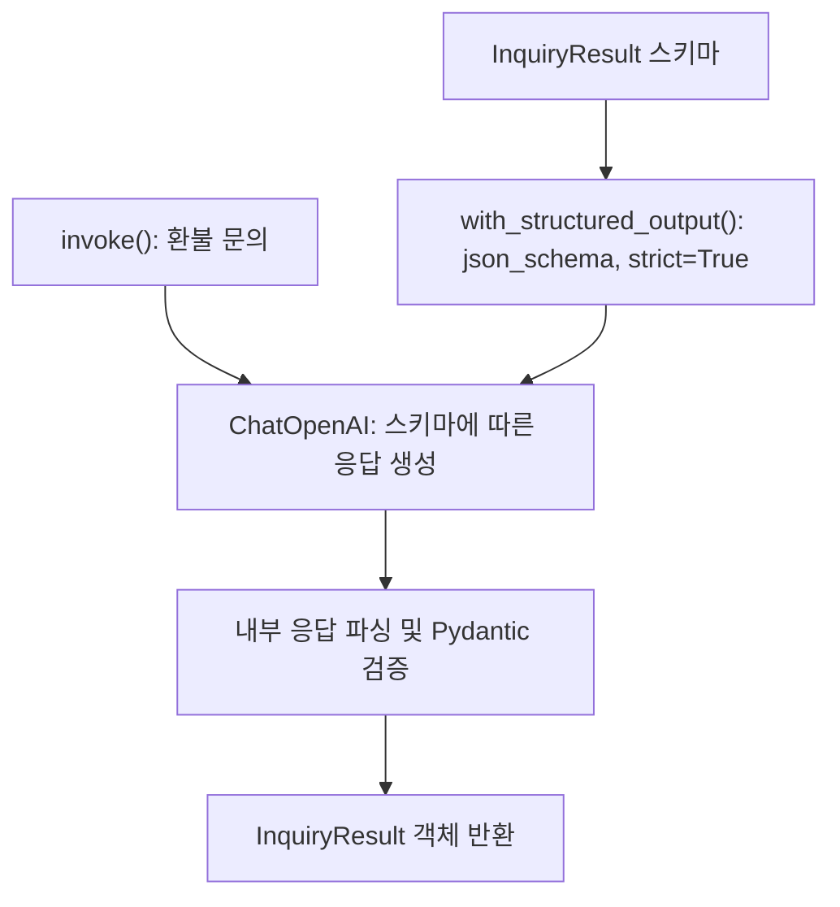
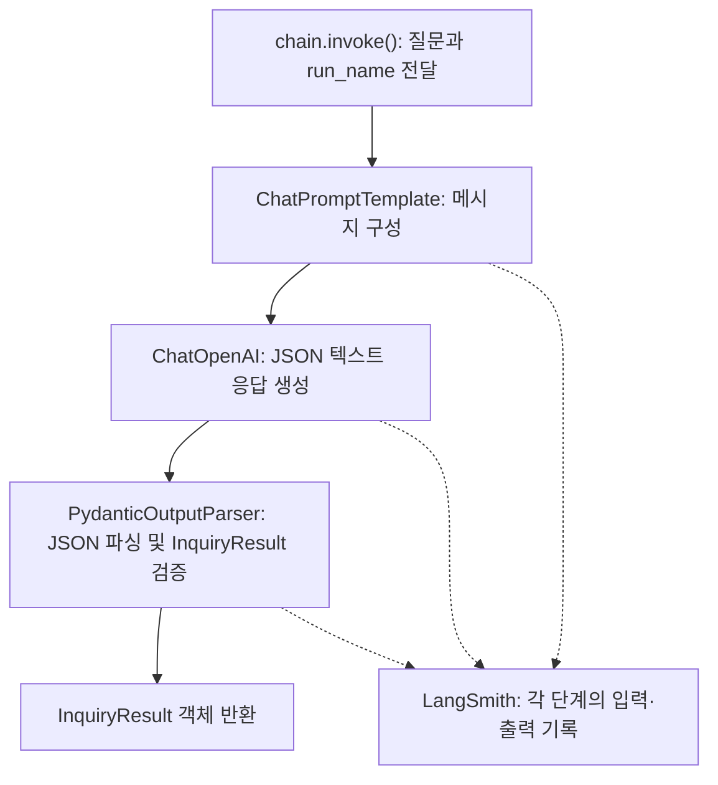
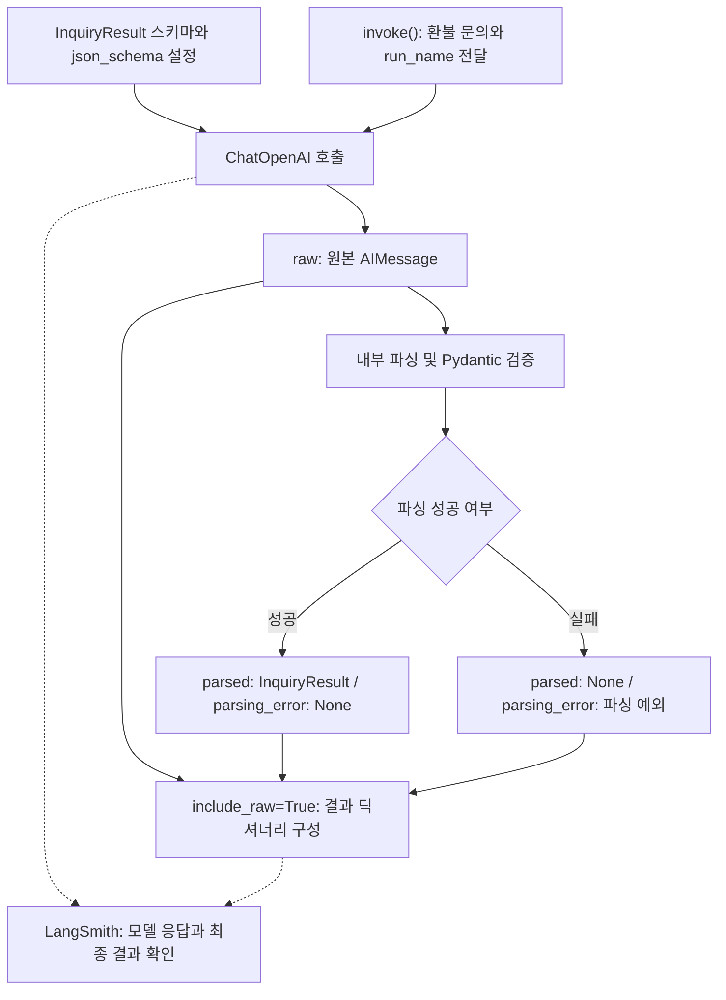
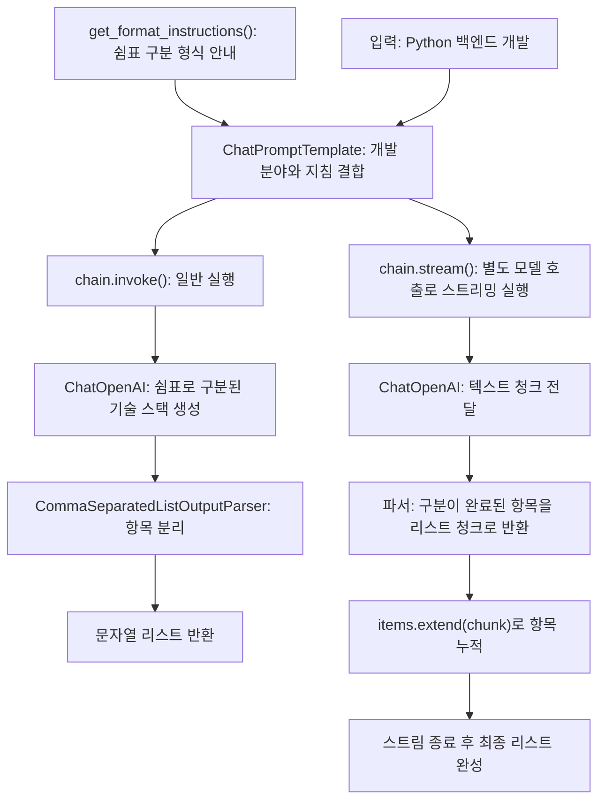
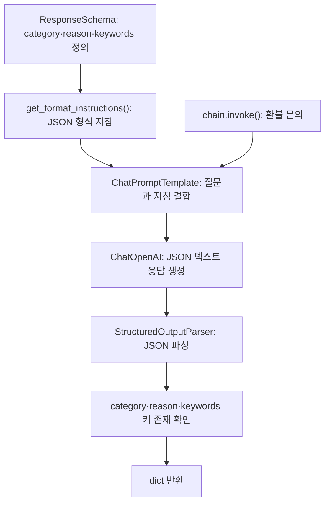
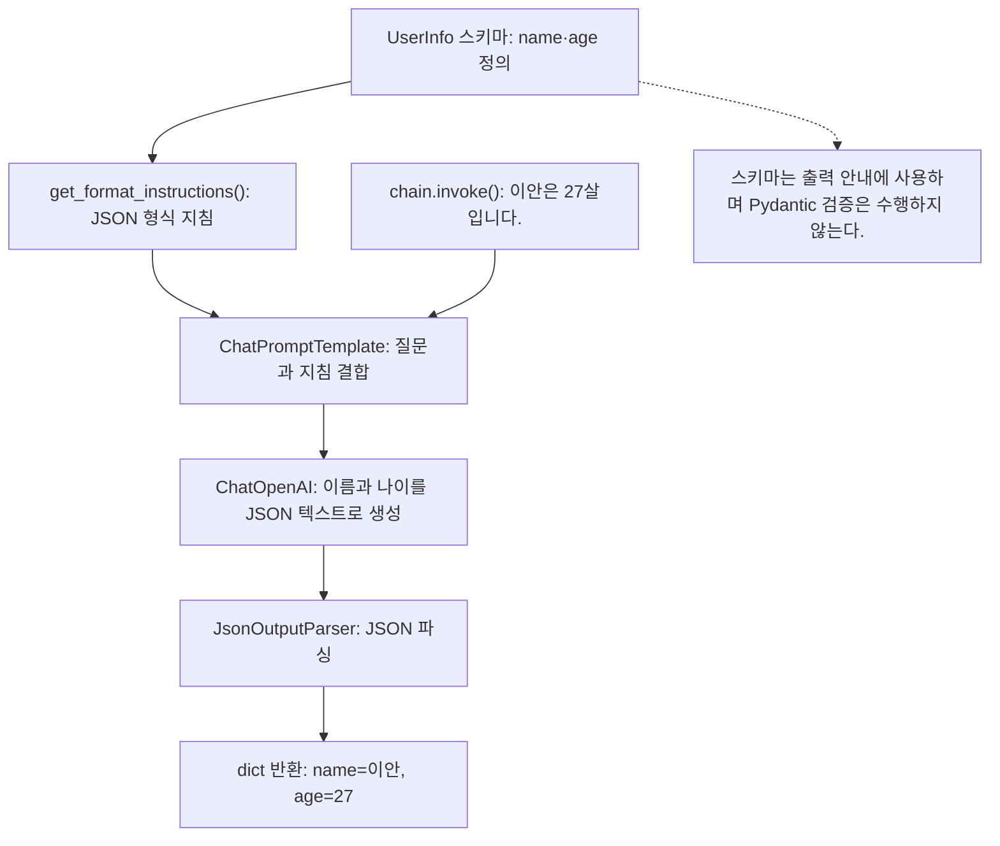
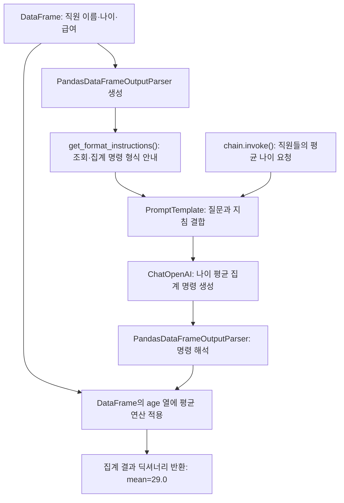
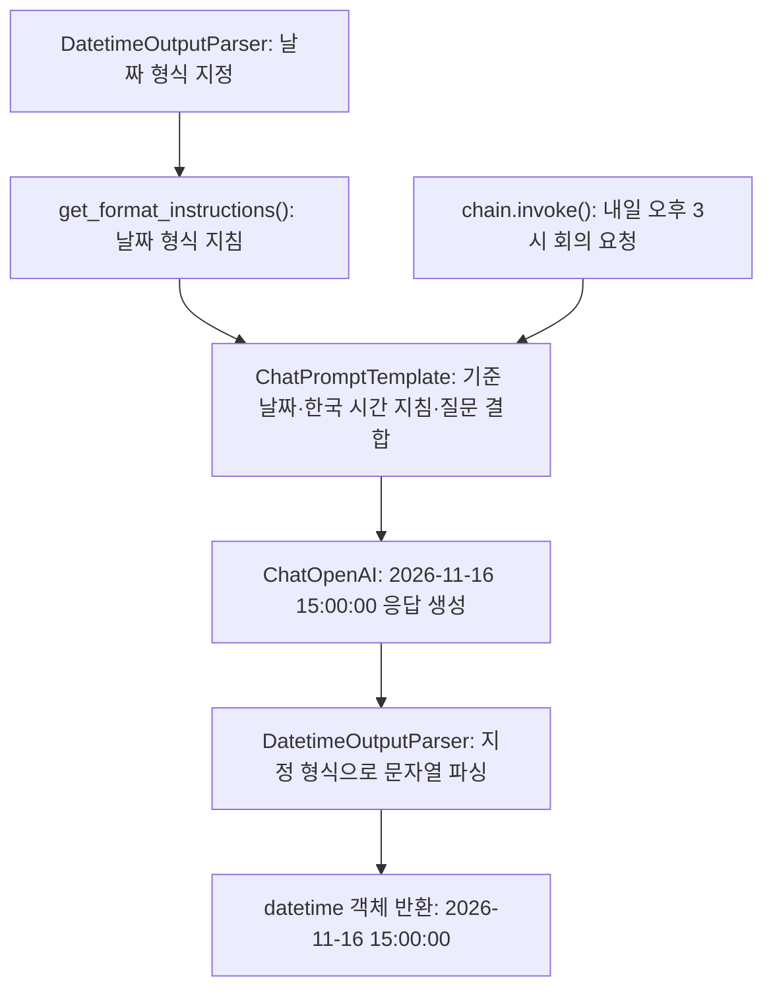
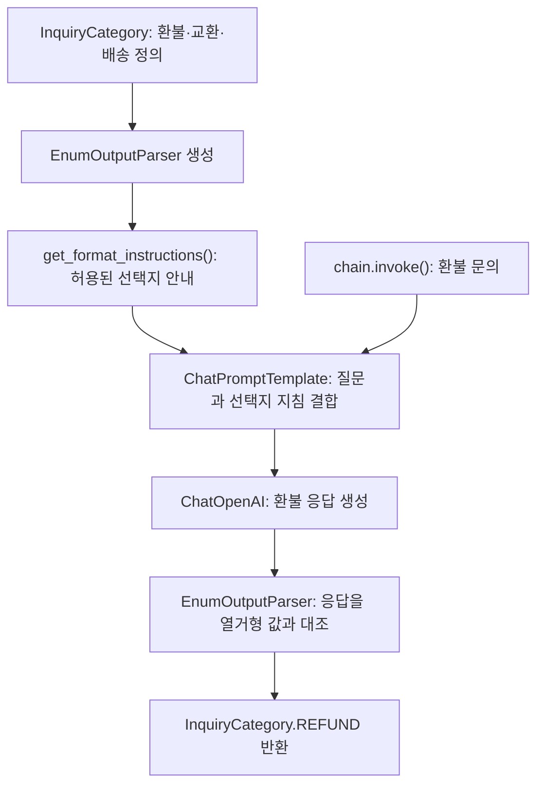

# Chapter 06. 출력 파서

## 출력 파서(Output Parser)
- LLM의 출력값을 구조화된 형식으로 변환하고 답변에서 원하는 정보만 뽑아낼 때 사용하는 도구이다.
- **출력 파서의 주요 특징**
    - **다양성**: LangChain은 많은 종류의 출력 파서를 제공해 다양한 변환 방식에 대응할 수 있다.
    - **스트리밍 지원**: 여러 출력 파서가 스트리밍을 지원해 실시간 데이터 처리가 가능하다.
    - **확장성**: 확장 가능한 인터페이스를 제공해 최소한의 모듈에서 복잡한 모듈까지 필요한 기능을 확장할 수 있다.
- **출력 파서의 이점**
    - **구조화**: LLM의 자유 형식 텍스트 출력을 구조화된 데이터로 변환해 정보를 체계적으로 관리할 수 있다.
    - **일관성**: 출력 형식을 일관되게 유지하여 후속 처리나 데이터 조회가 쉽고 효율적이다.
    - **유연성**: JSON, 리스트, 딕셔너리 등 다양한 출력 형식으로 변환 가능하여 유연성을 제공한다.

## PydanticOutputParser
```python
from typing import Literal

from pydantic import BaseModel, Field
from langchain_core.prompts import ChatPromptTemplate
from langchain_core.output_parsers import PydanticOutputParser
from langchain_openai import ChatOpenAI


# 1. 응답 스키마 정의
class InquiryResult(BaseModel):
    category: Literal["환불", "교환", "배송"] = Field(
        description="사용자 문의의 분류 결과"
    )
    reason: str = Field(
        description="해당 카테고리로 분류한 이유"
    )


# 2. Pydantic 출력 파서 생성
parser = PydanticOutputParser(
    pydantic_object=InquiryResult
)


# 3. 프롬프트 생성
prompt = ChatPromptTemplate.from_messages([
    (
        "system",
        "당신은 고객 문의 분류 전문가입니다.\n"
        "다음 출력 형식을 반드시 준수하세요.\n"
        "{format_instructions}"
    ),
    ("human", "{question}"),
]).partial(
    format_instructions=parser.get_format_instructions()
)


# 4. LLM 생성
llm = ChatOpenAI(
    model="gpt-4o-mini",
    temperature=0
)


# 5. 체인 구성
chain = prompt | llm | parser


# 6. 실행
result = chain.invoke({
    "question": "결제한 상품을 취소하고 환불받고 싶어요."
})

print(result)
print(type(result))
print(result.category)
print(result.reason)

# 출력
# category='환불' reason='결제한 상품의 취소와 환불을 요청했습니다.'
# <class '__main__.InquiryResult'>
# 환불
# 결제한 상품의 취소와 환불을 요청했습니다.
```

<details>
<summary>위 예시 코드 흐름도 보기</summary>



</details>

- Pydantic은 파이썬에서 데이터 유효성을 검사하고, 구조화된 형식으로 관리하는 데 유용한 라이브러리이다.
- PydanticOutputParser는 언어 모델의 출력을 구조화된 정보로 변환하는 데 도움을 주는 클래스이다.
- **핵심 메서드**
    - `get_format_instructions()`: 언어 모델이 출력해야 할 정보의 형식을 정의하는 지침을 제공한다.
    - `parse()`: 언어 모델의 출력을 받아 이를 특정 구조로 분석하고 변환한다.

## with_structured_output()
```python
from typing import Literal

from pydantic import BaseModel, Field
from langchain_openai import ChatOpenAI


# 1. 출력 스키마 정의
class InquiryResult(BaseModel):
    category: Literal["환불", "교환", "배송"] = Field(
        description="사용자 문의의 분류 결과"
    )
    reason: str = Field(
        description="해당 카테고리로 분류한 이유"
    )


# 2. LLM 생성
llm = ChatOpenAI(
    model="gpt-4o-mini",
    temperature=0,
)

# 3. 구조화 출력 설정
structured_llm = llm.with_structured_output(
    InquiryResult,
    method="json_schema",
    strict=True,
)

# 4. 실행
result = structured_llm.invoke(
    "결제한 상품을 취소하고 환불받고 싶어요."
)

print(result)
print(type(result))
print(result.category)
print(result.reason)

# 출력
# category='환불' reason='결제 취소 및 환불을 요청했습니다.'
# <class '__main__.InquiryResult'>
# 환불
# 결제 취소 및 환불을 요청했습니다.
```

<details>
<summary>위 예시 코드 흐름도 보기</summary>



</details>


## LangSmith에서 출력 파서의 흐름 확인하기
- LangSmith의 트레이스(trace)는 체인 실행 전체를 기록하며, 하위 실행(run)을 통해 프롬프트, 모델, 출력 파서의 입력과 출력을 확인할 수 있다.
- 위의 두 예제를 같은 질문으로 실행하고, 모델이 생성한 원본 응답이 `InquiryResult`로 변환되는 과정을 비교한다.

### 1. PydanticOutputParser의 흐름 확인하기
- 위 `PydanticOutputParser` 예제의 실행 부분을 다음 코드로 바꾼다. `prompt`, `llm`, `parser`, `InquiryResult`는 해당 예제에서 정의한 객체를 사용한다.

```python
chain = prompt | llm | parser

result = chain.invoke(
    {"question": "결제한 상품을 취소하고 환불받고 싶어요."},
    config={"run_name": "pydantic-output-parser"},
)

assert isinstance(result, InquiryResult)
print(result.model_dump())
```

<details>
<summary>위 예시 코드 흐름도 보기</summary>



</details>


1. LangSmith에서 예제의 실행 기록이 저장된 프로젝트 또는 에이전트 환경을 연다.
2. 실행 목록에서 `pydantic-output-parser` 트레이스를 선택하고, 상세 화면의 실행 트리를 펼친다.
3. `ChatPromptTemplate`, `ChatOpenAI`, `PydanticOutputParser`를 차례로 선택하여 각 단계의 입력(Input)과 출력(Output)을 비교한다.

```text
pydantic-output-parser
├── ChatPromptTemplate       질문과 출력 형식 지침으로 메시지를 구성한다.
├── ChatOpenAI               메시지를 받아 JSON 형식의 응답을 생성한다.
└── PydanticOutputParser     응답을 파싱하고 InquiryResult 스키마로 검증한다.
```

| 실행 단계 | 확인할 내용 |
| --- | --- |
| ChatPromptTemplate | `{question}`과 `{format_instructions}`가 실제 질문 및 스키마 지침으로 채워졌는지 확인한다. |
| ChatOpenAI | 파싱 전 응답에 `category`와 `reason`이 포함되어 있는지 확인한다. |
| PydanticOutputParser | 모델 응답이 입력으로 전달되고, 출력에 검증된 `category`와 `reason`이 나타나는지 확인한다. |
| 최상위 체인 | 전체 실행의 최종 결과와 성공 여부를 확인한다. |

- `get_format_instructions()`는 체인 실행 전에 호출하므로 위 실행 트리에 별도 단계로 나타나지 않는다. 생성된 지침은 프롬프트 단계의 출력에서 확인한다.
- 파이썬에서 반환되는 값은 `InquiryResult` 객체이며, LangSmith 화면에서는 직렬화된 필드 형태로 표시될 수 있다.

### 2. with_structured_output()의 흐름 비교하기
- 위 `with_structured_output()` 예제에서 구조화 출력 설정과 실행 부분을 다음 코드로 바꾼다. `llm`과 `InquiryResult`는 해당 예제의 정의를 사용한다.

```python
structured_llm = llm.with_structured_output(
    InquiryResult,
    method="json_schema",
    strict=True,
    include_raw=True,
)

result = structured_llm.invoke(
    "결제한 상품을 취소하고 환불받고 싶어요.",
    config={"run_name": "structured-output"},
)

print(result["raw"])
print(result["parsed"])
print(result["parsing_error"])
```

<details>
<summary>위 예시 코드 흐름도 보기</summary>



</details>


- LangSmith에서 `structured-output` 트레이스를 열고, 모델 호출의 입력·출력과 최상위 실행의 최종 출력을 비교한다.
- `include_raw=True`를 설정하면 기존 예제와 달리 `InquiryResult`만 반환하지 않고 다음 세 항목을 가진 딕셔너리를 반환한다.

| 항목 | 확인할 내용 |
| --- | --- |
| `raw` | 모델이 반환한 원본 `AIMessage`를 확인한다. |
| `parsed` | 파싱에 성공한 `InquiryResult`를 확인한다. 파싱에 실패하면 `None`이다. |
| `parsing_error` | 정상적으로 파싱되면 `None`이며, 실패하면 파싱 오류를 확인한다. |

- 내부 실행 이름과 트리 구조는 LangChain 버전에 따라 달라질 수 있으므로, 노드 이름보다 모델의 원본 응답과 최종 변환 결과를 비교한다.

### 3. 오류가 발생한 단계 확인하기
- JSON 형식이 잘못되었거나 `category`에 허용되지 않은 값이 들어오면 `PydanticOutputParser` 단계의 오류와 입력을 확인한다. 모델 응답이 문제인지, 기대한 스키마가 문제인지 구분한다.
- `include_raw=True`에서는 파싱 오류가 반환값에 담겨 최상위 실행이 성공으로 보일 수 있다. 성공 표시만 보지 않고 `parsed`와 `parsing_error`를 함께 확인한다.
- 인증 오류나 모델 API 요청 오류는 파싱 이전에 발생한다. 이 경우 모델 실행의 오류를 확인하며, 모든 오류가 `parsing_error`에 담기는 것은 아니다.

## 쉼표로 구분된 리스트 출력 파서(CommaSeparatedListOutputParser)
```python
from langchain_core.prompts import ChatPromptTemplate
from langchain_core.output_parsers import CommaSeparatedListOutputParser
from langchain_openai import ChatOpenAI

# 1. 출력 파서
parser = CommaSeparatedListOutputParser()

# 2. 프롬프트
prompt = ChatPromptTemplate.from_messages([
    (
        "system",
        "당신은 소프트웨어 개발 전문가입니다.\n"
        "입력한 개발 분야에 적합한 기술 스택 5개를 추천하세요.\n"
        "{format_instructions}"
    ),
    ("human", "{category}"),
]).partial(
    format_instructions=parser.get_format_instructions()
)

# 3. LLM
llm = ChatOpenAI(
    model="gpt-4o-mini",
    temperature=0
)

# 4. 체인
chain = prompt | llm | parser

# 일반 실행
result = chain.invoke({
    "category": "Python 백엔드 개발"
})

print("일반 실행:", result)

# 스트리밍 실행
print("\n스트리밍 실행:")

items = []

for chunk in chain.stream({
    "category": "Python 백엔드 개발"
}):
    print(chunk, flush=True)
    items.extend(chunk)

print("최종 리스트:", items)

# 출력
# 일반 실행:
# ['FastAPI', 'SQLAlchemy', 'PostgreSQL', 'Redis', 'Celery']

# 스트리밍 실행:
# ['FastAPI']
# ['SQLAlchemy']
# ['PostgreSQL']
# ['Redis']
# ['Celery']

# 최종 리스트:
# ['FastAPI', 'SQLAlchemy', 'PostgreSQL', 'Redis', 'Celery']
```

<details>
<summary>위 예시 코드 흐름도 보기</summary>



</details>

- 쉼표(,)로 구분된 항목을 리스트 형식으로 출력하는 파서이다.
- 요청된 정보를 문자열이 아닌 정형화된 리스트 형태로 제공할 수 있어 후처리 작업이 용이하다.

## 구조화된 출력 파서(StructuredOutputParser)
```python
from langchain_classic.output_parsers import (
    ResponseSchema,
    StructuredOutputParser,
)
from langchain_core.prompts import ChatPromptTemplate
from langchain_openai import ChatOpenAI


# 1. 출력 스키마 정의
response_schemas = [
    ResponseSchema(
        name="category",
        description="문의 유형: 환불, 교환, 배송 중 하나",
        type="string",
    ),
    ResponseSchema(
        name="reason",
        description="해당 유형으로 분류한 이유",
        type="string",
    ),
    ResponseSchema(
        name="keywords",
        description="문의의 핵심 키워드 목록",
        type="List[string]",
    ),
]

# 2. 출력 파서 생성
parser = StructuredOutputParser.from_response_schemas(
    response_schemas
)

# 3. 프롬프트 생성
prompt = ChatPromptTemplate.from_messages([
    (
        "system",
        "당신은 고객 문의 분석 전문가입니다.\n"
        "문의 내용을 분석하고 다음 형식으로 응답하세요.\n"
        "{format_instructions}"
    ),
    ("human", "{question}"),
]).partial(
    format_instructions=parser.get_format_instructions()
)

# 4. LLM
llm = ChatOpenAI(
    model="gpt-4o-mini",
    temperature=0,
)

# 5. 체인 구성
chain = prompt | llm | parser

# 6. 실행
result = chain.invoke({
    "question": "결제한 상품을 취소하고 환불받고 싶어요."
})

print(result)
print(type(result))
print(result["category"])
print(result["keywords"])

# 출력
# {
#     'category': '환불',
#     'reason': '결제 취소와 환불을 요청했습니다.',
#     'keywords': ['결제', '취소', '환불']
# }

# <class 'dict'>
# 환불
# ['결제', '취소', '환불']
```

<details>
<summary>위 예시 코드 흐름도 보기</summary>



</details>

- LLM의 답변을 딕셔너리 형식으로 정의하고, 키와 값의 쌍으로 여러 필드를 반환하는 데이터 구조화에 유용하다.
- GPT, Claude 모델보다 인텔리전스가 낮은 로컬 모델에 더 적합할 수 있다.
- 로컬 모델에서는 인텔리전스가 부족할 수 있기 때문에 description의 내용을 영어로 작성하는 것이 낫다.

## JSON 형식 출력 파서(JsonOutputParser)
```python
from pydantic import BaseModel, Field
from langchain_core.prompts import ChatPromptTemplate
from langchain_core.output_parsers import JsonOutputParser
from langchain_openai import ChatOpenAI


# 1. Pydantic 스키마 정의
class UserInfo(BaseModel):
    name: str = Field(description="사용자 이름")
    age: int = Field(description="사용자 나이")


# 2. JsonOutputParser 생성
parser = JsonOutputParser(
    pydantic_object=UserInfo
)

# 3. 프롬프트 생성
prompt = ChatPromptTemplate.from_messages([
    (
        "system",
        "사용자 문장에서 이름과 나이를 추출하세요.\n"
        "{format_instructions}"
    ),
    ("human", "{question}"),
]).partial(
    format_instructions=parser.get_format_instructions()
)

# 4. LLM 생성
llm = ChatOpenAI(
    model="gpt-4o-mini",
    temperature=0,
)

# 5. 체인 구성
chain = prompt | llm | parser

# 6. LLM 호출
result = chain.invoke({
    "question": "이안은 27살입니다."
})

print(result)
print(type(result))
print(result["name"])
print(result["age"])

# 출력
# {'name': '이안', 'age': 27}
# <class 'dict'>
# 이안
# 27
```

<details>
<summary>위 예시 코드 흐름도 보기</summary>



</details>

- LLM이 데이터를 조회하고 결과를 도출할 때 답변으로 단순한 문자열이 아니라 지정된 스키마에 맞게 JSON 형식으로 데이터를 반환한다.
- 데이터를 정확하고 효율적으로 처리하여 사용자가 원하는 형태의 JSON을 생성하기 위해서는 모델의 용량이 충분히 커야 한다.
- 용량이 작은 모델에서는 오류가 발생할 수 있다.

## JSON 관련 출력 파서 비교

| 구분 | JsonOutputParser | StructuredOutputParser | PydanticOutputParser |
| --- | --- | --- | --- |
| 스키마 정의 | 선택 사항이다. | `ResponseSchema`로 정의한다. | Pydantic `BaseModel`로 정의한다. |
| 반환 타입 | `dict`, `list` 등 JSON 값에 대응하는 파이썬 타입이다. | `dict`이다. | Pydantic 모델 객체이다. |
| JSON 파싱 | 지원한다. | 지원한다. | 지원한다. |
| 필수 필드 확인 | 기본적으로 검사하지 않는다. | 지정한 키의 존재 여부를 확인한다. | 스키마에 정의된 필수 필드를 검증한다. |
| 타입 및 제약 조건 검증 | 수행하지 않는다. | 수행하지 않는다. | Pydantic을 통해 검증한다. |
| 주요 용도 | 유연한 JSON 처리에 사용한다. | 지정한 키를 가진 간단한 JSON 처리에 사용한다. | 타입과 필드 제약 조건이 중요한 응답 처리에 사용한다. |

- **한 줄 정리**: JSON 파싱만 필요하면 `JsonOutputParser`, 필수 키 확인까지 필요하면 `StructuredOutputParser`, 타입과 제약 조건 검증까지 필요하면 `PydanticOutputParser`를 사용한다.

## Pandas 데이터프레임 출력 파서(PandasDataFrameOutputParser)
```python
import pandas as pd

from langchain_classic.output_parsers import PandasDataFrameOutputParser
from langchain_core.prompts import PromptTemplate
from langchain_openai import ChatOpenAI


# 1. DataFrame 생성
df = pd.DataFrame({
    "name": ["이안", "철수", "영희", "민수"],
    "age": [24, 30, 27, 35],
    "salary": [3000, 4000, 3500, 5000],
})

# 2. 출력 파서 생성
parser = PandasDataFrameOutputParser(
    dataframe=df
)

# 3. 프롬프트 생성
prompt = PromptTemplate.from_template(
    template=(
        "사용자 질문을 DataFrame 조회 명령으로 변환하세요.\n"
        "{format_instructions}\n"
        "질문: {question}\n"
    ),
    partial_variables={
        "format_instructions": parser.get_format_instructions()
    },
)

# 4. LLM 생성
llm = ChatOpenAI(
    model="gpt-4o-mini",
    temperature=0,
)

# 5. 체인 생성
chain = prompt | llm | parser

# 6. 실행
result = chain.invoke({
    "question": "직원들의 평균 나이를 구해주세요."
})

print(result)

# 출력
# {"mean": 29.0}
```

<details>
<summary>위 예시 코드 흐름도 보기</summary>



</details>

- LLM이 자연어 질문을 Pandas 데이터프레임 조회·집계 명령으로 변환하도록 하고, 해당 명령을 실제 데이터프레임에 적용하여 결과를 반환하는 출력 파서이다.
- 임의의 Pandas 데이터프레임에서 데이터를 추출하고 이를 형식화된 딕셔너리 형태로 조회하며 연산 결과를 반환할 수도 있다.

### Pandas란?
- 파이썬에서 엑셀이나 CSV 데이터를 불러와 정제, 변환, 분석 등 구조화된 데이터를 처리하는 도구이다.
- 행과 열로 구성된 2차원 데이터 구조인 데이터프레임(DataFrame)으로 데이터를 처리한다.

## 날짜 형식 출력 파서(DatetimeOutputParser)
```python
from langchain_classic.output_parsers import DatetimeOutputParser
from langchain_core.prompts import ChatPromptTemplate
from langchain_openai import ChatOpenAI


# 1. 출력 파서 생성
parser = DatetimeOutputParser(
    format="%Y-%m-%d %H:%M:%S"
)

# 2. 프롬프트 생성
prompt = ChatPromptTemplate.from_messages([
    (
        "system",
        "당신은 일정 관리 AI 어시스턴트입니다.\n"
        "기준 날짜는 2026년 11월 15일입니다.\n"
        "모든 날짜와 시간은 한국 시간 기준으로 해석하세요.\n"
        "사용자의 요청에서 날짜와 시간을 추출하세요.\n"
        "{format_instructions}"
    ),
    ("human", "{question}"),
]).partial(
    format_instructions=parser.get_format_instructions()
)

# 3. LLM 생성
llm = ChatOpenAI(
    model="gpt-4o-mini",
    temperature=0
)

# 4. 체인 구성
chain = prompt | llm | parser

# 5. LLM 실행
result = chain.invoke({
    "question": "내일 오후 3시에 회의 일정 잡아줘."
})

print(result)
print(type(result))
print(result.year)
print(result.month)
print(result.day)
print(result.hour)

# 출력
# 2026-11-16 15:00:00
# <class 'datetime.datetime'>
# 2026
# 11
# 16
# 15
```

<details>
<summary>위 예시 코드 흐름도 보기</summary>



</details>

- LLM의 출력을 datetime 형식으로 파싱하는 데 사용한다.

## 열거형 출력 파서(EnumOutputParser)
```python
from enum import Enum

from langchain_classic.output_parsers import EnumOutputParser
from langchain_core.prompts import ChatPromptTemplate
from langchain_openai import ChatOpenAI


# 1. Enum 정의
class InquiryCategory(str, Enum):
    REFUND = "환불"
    EXCHANGE = "교환"
    DELIVERY = "배송"


# 2. 출력 파서 생성
parser = EnumOutputParser(
    enum=InquiryCategory
)


# 3. 프롬프트 생성
prompt = ChatPromptTemplate.from_messages([
    (
        "system",
        "당신은 고객 문의 분류 전문가입니다.\n"
        "사용자 문의를 분석하여 가장 적절한 유형 하나를 선택하세요.\n"
        "{format_instructions}"
    ),
    ("human", "{question}"),
]).partial(
    format_instructions=parser.get_format_instructions()
)


# 4. LLM 생성
llm = ChatOpenAI(
    model="gpt-4o-mini",
    temperature=0,
)


# 5. 체인 구성
chain = prompt | llm | parser


# 6. 실행
result = chain.invoke({
    "question": "결제한 상품을 취소하고 환불받고 싶어요."
})

print(result)
print(type(result))
print(result.name)
print(result.value)

# 출력
# InquiryCategory.REFUND
# <enum 'InquiryCategory'>
# REFUND
# 환불
```

<details>
<summary>위 예시 코드 흐름도 보기</summary>



</details>

- LLM의 출력을 미리 정의된 열거형 값 중 하나로 파싱하는 도구
- 정해진 선택지를 미리 전달하고 그중에서 하나를 골라서 답변할 수 있게 하므로 출력 데이터의 일관성을 유지하고 예측 가능성을 높일 수 있다.

### Enum(enumeration)이란?
- 열거형이라고도 부르며, 동등한 레벨에 있는 데이터들을 하나의 구조로 묶어 표현하는 방식이다.
