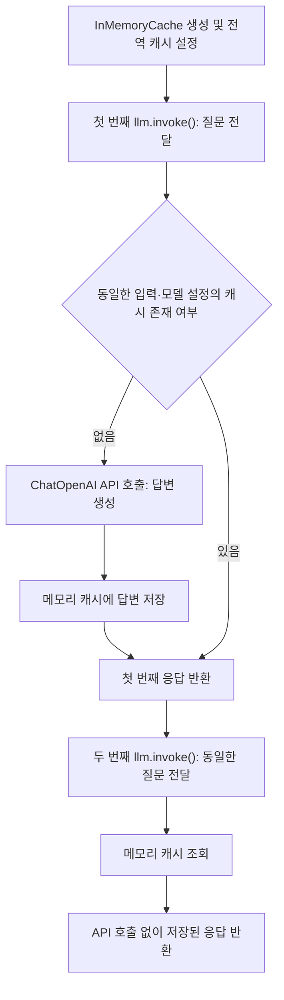
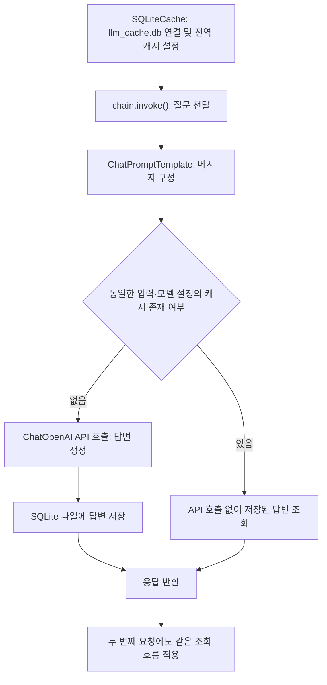

# Chapter 07. 모델

## RAG에서 LLM의 역할과 모델의 종류
- LLM은 RAG 시스템에서 두뇌 역할을 하는 핵심 구성 요소이다.
- GPT 외에도 Claude, Gemini, Hugging Face의 오픈소스 LLM 등 다양한 모델을 사용할 수 있다.
- LLM을 교체하는 주된 이유는 비용과 성능, 사용 편의성, 보안 문제이다.

## 다양한 LLM 활용
### 공통 매개변수
- `temperature`:
    - 샘플링 온도로 응답 생성의 무작위성을 조절한다.
    - 일반적으로 값이 높으면 표현이 다양해지고, 낮으면 응답이 더 일관되는 경향이 있다.
    - 허용 범위와 지원 여부는 모델 및 추론 설정에 따라 다르다.
- `max_tokens`:
    - 생성할 응답의 최대 토큰 수를 지정한다.
    - 값이 작으면 답변이 끝나기 전에 생성이 중단될 수 있다.
    - 기본값과 출력 한도, 추론 토큰의 포함 여부는 모델별로 확인한다.
- `model`:
    - 호출할 모델의 API 식별자를 지정한다.
    - 매개변수 이름과 별칭(`model_name` 등)의 지원 여부는 연동 클래스에 따라 확인한다.

- 각 예제는 해당 제공업체의 API 키가 설정된 환경에서 실행한다.
- `StrOutputParser`로 응답 텍스트를 추출하고, `.stream()`으로 전달되는 문자열 청크를 즉시 출력한다.

### OpenAI 모델

```python
from langchain_openai import ChatOpenAI
from langchain_core.output_parsers import StrOutputParser

llm = ChatOpenAI(model="gpt-4o-mini")
chain = llm | StrOutputParser()

for chunk in chain.stream("사랑이 뭔가요?"):
    print(chunk, end="", flush=True)
```

- OpenAI가 제공하는 모델을 사용한다.
- `langchain_openai` 라이브러리의 `ChatOpenAI` 클래스를 사용한다.

### Claude 모델

```python
from langchain_anthropic import ChatAnthropic
from langchain_core.output_parsers import StrOutputParser

llm = ChatAnthropic(model="claude-sonnet-4-6")
chain = llm | StrOutputParser()

for chunk in chain.stream("사랑이 뭔가요?"):
    print(chunk, end="", flush=True)
```

- Anthropic이 제공하는 Claude 모델을 사용한다.
- 추론 설정에 따라 샘플링 옵션의 지원 여부와 토큰 예산을 확인한다.
- `langchain_anthropic` 라이브러리의 `ChatAnthropic` 클래스를 사용한다.

### DeepSeek 모델

```python
from langchain_deepseek import ChatDeepSeek
from langchain_core.output_parsers import StrOutputParser

llm = ChatDeepSeek(model="deepseek-flash")
chain = llm | StrOutputParser()

for chunk in chain.stream("사랑이 뭔가요?"):
    print(chunk, end="", flush=True)
```

- DeepSeek의 호스팅 API를 사용한다.
- `langchain_deepseek` 라이브러리의 `ChatDeepSeek` 클래스를 사용한다. 공개 모델을 로컬에서 실행하는 경우에는 실행 환경에 맞는 별도 연동을 사용한다.

### Cohere 모델

```python
from langchain_cohere import ChatCohere
from langchain_core.output_parsers import StrOutputParser

llm = ChatCohere(model="command-a-03-2025")
chain = llm | StrOutputParser()

for chunk in chain.stream("사랑이 뭔가요?"):
    print(chunk, end="", flush=True)
```

- Cohere가 제공하는 Command 계열 등의 채팅 모델을 사용한다.
- 임베딩용 Embed 모델이나 검색 결과 재정렬용 Rerank 모델과 구분한다.
- `langchain_cohere` 라이브러리의 `ChatCohere` 클래스를 사용한다.

### Upstage 모델

```python
from langchain_upstage import ChatUpstage
from langchain_core.output_parsers import StrOutputParser

llm = ChatUpstage(model="solar-pro")
chain = llm | StrOutputParser()

for chunk in chain.stream("사랑이 뭔가요?"):
    print(chunk, end="", flush=True)
```

- Upstage가 제공하는 Solar 모델을 사용한다.
- `langchain_upstage` 라이브러리의 `ChatUpstage` 클래스를 사용한다.

## LLM 답변 캐싱하기
- 캐싱(caching)이란 동일한 질문이 발생하면 그에 대한 답변을 별도의 공간에 저장해 두는 것을 말한다.
- 동일한 질문을 반복해서 요청하는 경우에도 다시 요청하지 않고 저장된 캐시 정보에서 답변을 불러오게 하여 비용을 절감한다.

### InMemory Cache
```python
import time

from langchain_core.caches import InMemoryCache
from langchain_core.globals import set_llm_cache
from langchain_openai import ChatOpenAI


# 1. 캐시 생성 및 전역 설정
cache = InMemoryCache()
set_llm_cache(cache)

# 2. LLM 생성
llm = ChatOpenAI(
    model="gpt-4o-mini",
    temperature=0,
)

question = "Python이란 무엇인가?"

# 3. 첫 번째 요청 (Cache Miss)
start = time.perf_counter()

response1 = llm.invoke(question)

print("첫 번째 응답:", response1.content)
print("소요 시간:", time.perf_counter() - start)


# 4. 두 번째 요청 (Cache Hit)
start = time.perf_counter()

response2 = llm.invoke(question)

print("두 번째 응답:", response2.content)
print("소요 시간:", time.perf_counter() - start)

# 출력
# 첫 번째 응답: Python은 범용 프로그래밍 언어입니다.
# 소요 시간: 1.24

# 두 번째 응답: Python은 범용 프로그래밍 언어입니다.
# 소요 시간: 0.001
```

<details>
<summary>위 예시 코드 흐름도 보기</summary>



</details>

- 메모리 공간을 활용해 동일한 질문에 대한 답변을 일시적으로 저장한다.
- 동일한 요청이 반복될 경우 캐시된 응답을 즉시 반환한다.
- 인메모리 캐시는 프로그램 종료 시 메모리가 초기화되면서 캐시가 모두 사라지기 때문에 재시작 시 캐시를 다시 만들어야 하는 단점이 있다.

### SQLite Cache
```python
import time

from langchain_community.cache import SQLiteCache
from langchain_core.globals import set_llm_cache
from langchain_core.prompts import ChatPromptTemplate
from langchain_openai import ChatOpenAI


# 1. SQLite 캐시 설정
cache = SQLiteCache(
    database_path="./llm_cache.db"
)

set_llm_cache(cache)


# 2. 프롬프트 생성
prompt = ChatPromptTemplate.from_messages([
    ("system", "당신은 Python 개발 전문가입니다."),
    ("human", "{question}"),
])


# 3. LLM 생성
llm = ChatOpenAI(
    model="gpt-4o-mini",
    temperature=0,
)


# 4. 체인 생성
chain = prompt | llm


# 5. 동일한 질문 두 번 실행
for i in range(2):
    start = time.perf_counter()

    result = chain.invoke({
        "question": "Python의 데코레이터란 무엇인가?"
    })

    elapsed = time.perf_counter() - start

    print(f"\n{i + 1}번째 요청")
    print("응답:", result.content)
    print(f"소요 시간: {elapsed:.4f}초")

# 출력
# 1번째 요청
# 응답: Python의 데코레이터는 함수의 동작을 확장하는 기능입니다.
# 소요 시간: 1.2531초

# 2번째 요청
# 응답: Python의 데코레이터는 함수의 동작을 확장하는 기능입니다.
# 소요 시간: 0.0042초
```

<details>
<summary>위 예시 코드 흐름도 보기</summary>



</details>

- 데이터베이스 파일을 활용해 캐시 데이터를 저장하여 프로그램을 재시작해도 캐시 정보를 유지할 수 있다.
- 장기적인 데이터 저장이 필요한 서비스에서 유용하다.

## 직렬화와 역직렬화로 모델 저장 및 로드하기
- `직렬화`: 데이터 구조나 객체의 상태를 저장하거나 전송하기 위해 일련의 바이트(byte)나 문자열 형식으로 변환하는 과정이다.
- `역직렬화`: 직렬화된 데이터를 원래 객체나 데이터 구조의 형태로 복원하는 과정이다.
- RAG 시스템에서는 모델 설정과 체인 구성을 저장하고 복원하는 데 직렬화를 활용한다.
- 예를 들어, 체인을 JSON 형식으로 직렬화하여 파일로 저장하고 나중에 복원할 수 있다.

### 직렬화 가능 여부 확인하기
```python
import os
from langchain_openai import ChatOpenAI
from langchain_core.prompts import PromptTemplate
from dotenv import load_dotenv

prompt = PromptTemplate.from_template("{fruit}의 색상이 무엇입니까?")

llm = ChatOpenAI(model="gpt-3.5-turbo", temperature=0)

chain = prompt | llm

print(f"ChatOpenAI: {ChatOpenAI.is_lc_serializable()}")
print(f"ChatOpenAI: {llm.is_lc_serializable()}")
print(chain.is_lc_serializable())

# 출력
# ChatOpenAI: True
# ChatOpenAI: True
# True
```
- is_lc_serializable() 메서드를 사용해 llm 객체와 체인의 직렬화 가능 여부를 확인한다.

### 체인 직렬화하기
```python
from langchain_core.load import dumpd, dumps

dumpd_chain = dumpd(chain) # 딕셔너리로 직렬화
dumps_chain = dumps(chain) # 직렬화
```
- 직렬화 가능한 객체를 딕셔너리나 JSON 문자열로 변환하는 과정이다.
- 객체의 속성과 데이터를 키-값 쌍으로 된 딕셔너리 형태로 변환하므로, 객체를 쉽게 저장하고 전송하거나 재구성할 수 있다.
- dumps는 객체를 문자열로 직렬화하고, dumpd는 객체를 딕셔너리로 직렬화한다.

### Pickle 파일로 직렬화하고 로드하기
```python
import os
import pickle

from langchain_core.load import dumpd, load
from langchain_core.prompts import PromptTemplate
from langchain_core.runnables import RunnableSequence
from langchain_openai import ChatOpenAI

# 1. 저장할 체인을 생성한다.
prompt = PromptTemplate.from_template("{fruit}의 색상이 무엇입니까?")
llm = ChatOpenAI(model="gpt-4o-mini", temperature=0)
chain = prompt | llm

# 2. 체인 구성을 딕셔너리로 직렬화하고 Pickle 파일에 저장한다.
chain_data = dumpd(chain)
with open("chain.pkl", "wb") as file:
    pickle.dump(chain_data, file)

# 3. 직접 저장한 Pickle 파일을 읽는다.
with open("chain.pkl", "rb") as file:
    restored_data = pickle.load(file)

assert restored_data == chain_data

# 4. 딕셔너리에서 실행 가능한 체인을 복원한다.
restored_chain = load(
    restored_data,
    secrets_map={"OPENAI_API_KEY": os.environ["OPENAI_API_KEY"]},
    allowed_objects=[RunnableSequence, PromptTemplate, ChatOpenAI],
)

assert isinstance(restored_chain, RunnableSequence)

result = restored_chain.invoke({"fruit": "사과"})
print(result.content)
```

- Pickle은 파이썬 객체를 바이너리 형태로 저장하고 복원하는 포맷이다.
- `pickle.dump()`로 저장하고 `pickle.load()`로 읽으며, 파일은 각각 `wb`, `rb` 모드로 연다.
- API 클라이언트가 포함된 체인 자체는 Pickle로 저장되지 않을 수 있으므로, `dumpd()`로 만든 구성 딕셔너리를 저장하고 `load()`로 체인을 복원한다.
- 모델 가중치나 이전 응답이 아닌 체인 설정을 저장한다. 복원에 필요한 패키지와 `OPENAI_API_KEY`는 실행 환경에 준비해야 한다.
- Pickle은 로드할 때 코드를 실행할 수 있으므로 직접 생성하고 변조되지 않은 파일만 읽는다. `allowed_objects`는 LangChain 복원에만 적용되며 Pickle 로드 자체를 보호하지 않는다.

## GPT 모델의 토큰 사용량 확인하기
```python
from langchain_community.callbacks.manager import get_openai_callback
from langchain_openai import ChatOpenAI

llm = ChatOpenAI(model="gpt-4o-mini", temperature=0, cache=False)

with get_openai_callback() as callback:
    result = llm.invoke("대한민국의 수도는 어디야?")

    print("응답:", result.content)
    print("입력 토큰 수:", callback.prompt_tokens)
    print("출력 토큰 수:", callback.completion_tokens)
    print("전체 토큰 수:", callback.total_tokens)
    print("총 비용(USD):", callback.total_cost)
```

- get_openai_callback()을 이용하면 질문과 답변 과정에서 사용된 전체 사용 토큰 수, 프롬프트 및 응답에 사용된 토큰 수, 총 비용을 추적해서 확인할 수 있다.
- 이 예제는 OpenAI API의 사용량을 확인한다. 다른 제공업체는 해당 모델에 맞는 사용량 추적 방법을 확인한다.
- `with` 블록 안에서 완료된 모델 호출의 토큰 사용량을 집계한다. 여러 번 호출하면 해당 블록의 사용량이 누적된다.
- 앞의 캐시 예제에 영향을 받지 않도록 `cache=False`로 설정하여 실제 모델 호출의 사용량을 확인한다.
- 비용은 콜백에 등록된 모델 단가로 계산한 값이므로 실제 청구 금액과 다를 수 있다.
