# Chapter 08. 메모리

### 싱글 턴 대화와 멀티 턴 대화
- 싱글 턴 대화:
    - 한 번의 질문과 답변으로 끝나는 형태이다.
    - AI가 매번 새로운 질문을 처리하지만 이전 대화 내용을 참고하지 않는다.
- 멀티 턴 대화:
    - 사용자의 여러 차례 질문과 AI의 답변이 연속적으로 이어지는 방식이다.
    - 이전 대화 맥락을 유지하기 위해 메모리 기능이 필요하다.

## 대화 버퍼 메모리(ConversationBufferMemory)
```python
from langchain_classic.memory import ConversationBufferMemory

# 1. 메모리 생성
memory = ConversationBufferMemory(
    memory_key="history",
    return_messages=True,
)

# 2. 대화 저장
memory.save_context(
    {"input": "내 이름은 이안이야."},
    {"output": "반가워, 이안!"}
)

memory.save_context(
    {"input": "나는 백엔드 개발자야."},
    {"output": "백엔드 개발을 하고 있구나!"}
)

# 3. 저장된 대화 조회
history = memory.load_memory_variables({})

print(history)

# 출력
# {
#     "history": [
#         HumanMessage(content="내 이름은 이안이야."),
#         AIMessage(content="반가워, 이안!"),
#         HumanMessage(content="나는 백엔드 개발자야."),
#         AIMessage(content="백엔드 개발을 하고 있구나!")
#     ]
# }
```

<details>
<summary>내부 동작 방식 보기</summary>

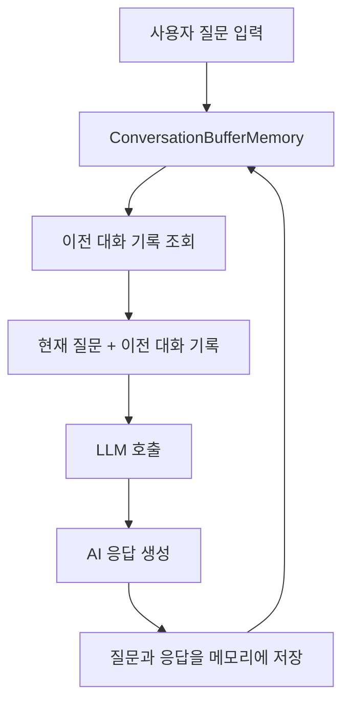

</details>

- 가장 기본적인 메모리 유형이다.
- 메시지를 저장한 후 변수를 이용해 메시지를 추출할 수 있다.
- 이 메모리는 사람의 입력과 AI의 답변을 짝지어서 저장한다.
- `save_context()`:
    - `ConversationBufferMemory`에 대화 내용을 하나씩 저장한다.
    - 저장한 질문과 답변의 쌍 하나를 턴(turn)이라고 부른다.

## 대화 버퍼 윈도우 메모리(ConversationBufferWindowMemory)
```python
from langchain_classic.memory import ConversationBufferWindowMemory

# 1. 메모리 생성
memory = ConversationBufferWindowMemory(
    memory_key="history",
    k=2,
    return_messages=True,
)

# 2. 첫 번째 대화
memory.save_context(
    {"input": "안녕하세요."},
    {"output": "반갑습니다!"}
)

# 3. 두 번째 대화
memory.save_context(
    {"input": "제 이름은 이안입니다."},
    {"output": "이안님, 반가워요."}
)

# 4. 세 번째 대화
memory.save_context(
    {"input": "저는 백엔드 개발자입니다."},
    {"output": "백엔드 개발을 하시는군요."}
)

# 5. 네 번째 대화
memory.save_context(
    {"input": "Python을 공부하고 있어요."},
    {"output": "Python 학습을 도와드릴게요."}
)

# 6. 최근 대화 기록 조회
result = memory.load_memory_variables({})

for message in result["history"]:
    print(type(message).__name__, ":", message.content)

# 출력
# HumanMessage : 저는 백엔드 개발자입니다.
# AIMessage : 백엔드 개발을 하시는군요.
# HumanMessage : Python을 공부하고 있어요.
# AIMessage : Python 학습을 도와드릴게요.
```

<details>
<summary>내부 동작 방식 보기</summary>

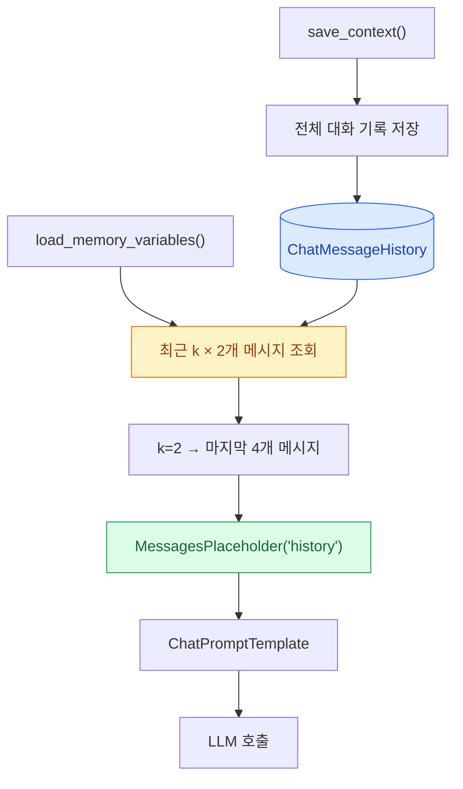

</details>

- `대화 버퍼 메모리(ConversationBufferMemory)`는 모든 대화 내용을 저장하기 때문에 모델이 허용하는 입력 토큰 허용치를 넘을 수 있다.
- 이럴 때 `대화 버퍼 윈도우 메모리(ConversationBufferWindowMemory)`를 통해서 최근 몇 턴의 대화를 불러올지 지정할 수 있다.
- `윈도우(window)`:
    - 조회할 최근 대화의 범위를 말한다.
    - 전체 대화 기록은 저장하되, 조회할 때 최근 `k × 2`개의 메시지만 반환한다.
    - 따라서 모델에 전달하는 대화 범위는 제한되지만, 전체 기록의 저장 공간이 일정하게 유지되는 것은 아니다.
    - 최근 대화의 턴 수는 `k` 값으로 지정한다. `k=2`이면 최대 두 턴, 즉 네 개의 메시지를 반환한다.

## 대화 토큰 버퍼 메모리(ConversationTokenBufferMemory)
```python
from langchain_classic.memory import ConversationTokenBufferMemory
from langchain_openai import ChatOpenAI

# 1. LLM 생성 (토큰 계산용)
llm = ChatOpenAI(
    model="gpt-4o-mini",
    temperature=0,
)

# 2. 메모리 생성
memory = ConversationTokenBufferMemory(
    llm=llm,
    memory_key="history",
    max_token_limit=100,
    return_messages=True,
)

# 3. 첫 번째 대화
memory.save_context(
    {"input": "안녕하세요."},
    {"output": "반갑습니다!"},
)

# 4. 두 번째 대화
memory.save_context(
    {"input": "제 이름은 이안입니다."},
    {"output": "이안님, 반가워요."},
)

# 5. 세 번째 대화
memory.save_context(
    {"input": "저는 백엔드 개발자입니다."},
    {"output": "백엔드 개발을 하시는군요."},
)

# 6. 네 번째 대화
memory.save_context(
    {"input": "Python을 공부하고 있어요."},
    {"output": "Python 학습을 도와드릴게요."},
)

# 7. 다섯 번째 대화
memory.save_context(
    {"input": "LangChain을 배우고 있습니다."},
    {"output": "LangChain은 LLM 애플리케이션 개발 프레임워크입니다."},
)

# 8. 여섯 번째 대화
memory.save_context(
    {"input": "LangGraph도 공부하려고 합니다."},
    {"output": "LangGraph는 상태 기반 에이전트 개발에 유용합니다."},
)

# 9. 메모리에 남아 있는 대화 조회
history = memory.load_memory_variables({})["history"]

print("=== 최종 대화 기록 ===")

for message in history:
    print(type(message).__name__, ":", message.content)

# 10. 최종 토큰 수 확인
token_count = llm.get_num_tokens_from_messages(history)

print(f"\n최종 토큰 수: {token_count}")
print(f"남은 메시지 수: {len(history)}")

# 출력
# === 최종 대화 기록 ===

# HumanMessage : LangChain을 배우고 있습니다.
# AIMessage : LangChain은 LLM 애플리케이션 개발 프레임워크입니다.
# HumanMessage : LangGraph도 공부하려고 합니다.
# AIMessage : LangGraph는 상태 기반 에이전트 개발에 유용합니다.

# 최종 토큰 수: 92
# 남은 메시지 수: 4
```

<details>
<summary>내부 동작 방식 보기</summary>

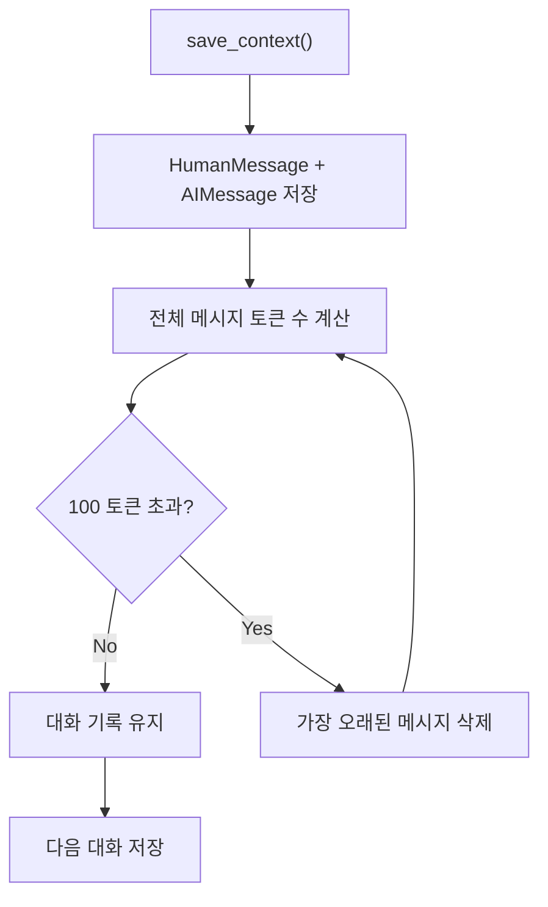

</details>

- 윈도우가 아닌 토큰 단위로 대화 기록을 조절하는 방법이다.
- 최대 토큰 길이는 max_token_limit 값으로 제한할 수 있다.

## 대화 엔티티 메모리(ConversationEntityMemory)
```python
from langchain_classic.chains import ConversationChain
from langchain_classic.memory import ConversationEntityMemory
from langchain_classic.memory.prompt import ENTITY_MEMORY_CONVERSATION_TEMPLATE
from langchain_openai import ChatOpenAI


# 1. LLM 생성
llm = ChatOpenAI(
    model="gpt-4o-mini",
    temperature=0,
)

# 2. 엔티티 메모리 생성
memory = ConversationEntityMemory(
    llm=llm,
    k=3,
    return_messages=False,
)

# 3. ConversationChain 생성
conversation = ConversationChain(
    llm=llm,
    prompt=ENTITY_MEMORY_CONVERSATION_TEMPLATE,
    memory=memory,
)

# 4. 첫 번째 대화
response1 = conversation.predict(
    input="Atlas는 제가 개발하는 청년 정책 추천 서비스입니다."
)
print("AI:", response1)

# 5. 두 번째 대화
response2 = conversation.predict(
    input="Atlas의 백엔드는 FastAPI이고 DB는 PostgreSQL입니다."
)
print("AI:", response2)

# 6. 저장된 엔티티 확인
print("\n=== Entity Store ===")
print(memory.entity_store.store)

# 7. 저장된 정보 활용
response3 = conversation.predict(
    input="Atlas는 어떤 서비스이고 어떤 기술을 사용하나요?"
)
print("\nAI:", response3)

# 출력
# AI: Atlas라는 청년 정책 추천 서비스를 개발하고 계시는군요.

# AI: FastAPI와 PostgreSQL을 사용하는군요.

# === Entity Store ===
# {
#     'Atlas': 'Atlas는 사용자가 개발하는 청년 정책 추천 서비스이며, 백엔드에 FastAPI와 PostgreSQL을 사용한다.'
# }

# AI: Atlas는 청년 정책을 추천하는 서비스입니다.
# 백엔드에는 FastAPI와 PostgreSQL을 사용합니다.
```

<details>
<summary>내부 동작 방식 보기</summary>

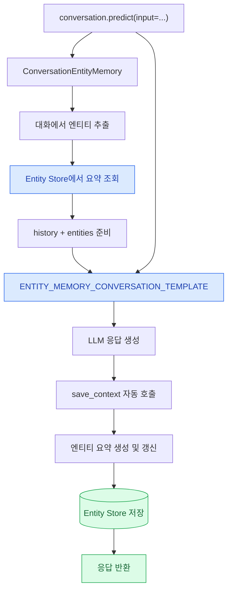

</details>

- 대화에서 엔티티를 추출하고, 엔티티별 정보를 요약하여 저장·갱신한다.
- 엔티티(entity)란 대화나 데이터에서 특정한 의미를 가지는 핵심 정보를 의미한다.
- ConversationChain은 LangChain에서 대화 흐름을 관리하는 객체로, LLM과 대화 메모리를 결합해 대화의 컨텍스트를 유지한다.
- predict() 메서드로 대화를 입력해 답변을 생성한다.
- ConversationEntityMemory는 주요 엔티티 정보를 별도로 저장한다.

## 대화 지식 그래프 메모리(ConversationKGMemory)
```python
from langchain_community.memory.kg import ConversationKGMemory
from langchain_classic.chains import ConversationChain
from langchain_core.prompts import PromptTemplate
from langchain_openai import ChatOpenAI


# 1. LLM 생성
llm = ChatOpenAI(
    model="gpt-4o-mini",
    temperature=0,
)

# 2. Knowledge Graph 메모리 생성
memory = ConversationKGMemory(
    llm=llm,
    k=2,
    return_messages=False,
)

# 3. 프롬프트 생성
prompt = PromptTemplate.from_template(
    """
당신은 친절한 AI 어시스턴트입니다.
아래 지식 그래프에서 조회한 정보를 참고하여 답변하세요.
정보가 없다면 모른다고 답하세요.

관련 지식:
{history}

Human: {input}
AI:
"""
)

# 4. ConversationChain 생성
conversation = ConversationChain(
    llm=llm,
    prompt=prompt,
    memory=memory,
)

# 5. 첫 번째 대화
response1 = conversation.predict(
    input="Atlas는 청년 정책을 추천하는 서비스입니다."
)
print("AI:", response1)

# 6. 두 번째 대화
response2 = conversation.predict(
    input="Atlas의 백엔드는 FastAPI로 개발합니다."
)
print("AI:", response2)

# 7. 세 번째 대화
response3 = conversation.predict(
    input="Atlas의 데이터베이스는 PostgreSQL을 사용합니다."
)
print("AI:", response3)

# 8. 저장된 Knowledge Triple 조회
print("\n=== Knowledge Graph ===")

for triple in memory.kg.get_triples():
    print(triple)

# 9. 저장된 관계를 활용한 질문
response4 = conversation.predict(
    input="Atlas는 어떤 기술을 사용하나요?"
)

print("\nAI:", response4)

# 출력
# AI: 청년 정책을 추천하는 Atlas 서비스군요.

# AI: FastAPI를 사용해 백엔드를 개발하고 계시군요.

# AI: 데이터베이스는 PostgreSQL을 사용하시는군요.

# === Knowledge Graph ===
# KnowledgeTriple(
#     subject='Atlas',
#     predicate='is',
#     object_='청년 정책 추천 서비스'
# )
# KnowledgeTriple(
#     subject='Atlas',
#     predicate='uses',
#     object_='FastAPI'
# )
# KnowledgeTriple(
#     subject='Atlas',
#     predicate='uses',
#     object_='PostgreSQL'
# )

# AI: Atlas는 백엔드에 FastAPI를 사용하고
# 데이터베이스로 PostgreSQL을 사용하는
# 청년 정책 추천 서비스입니다.
```

<details>
<summary>내부 동작 방식 보기</summary>

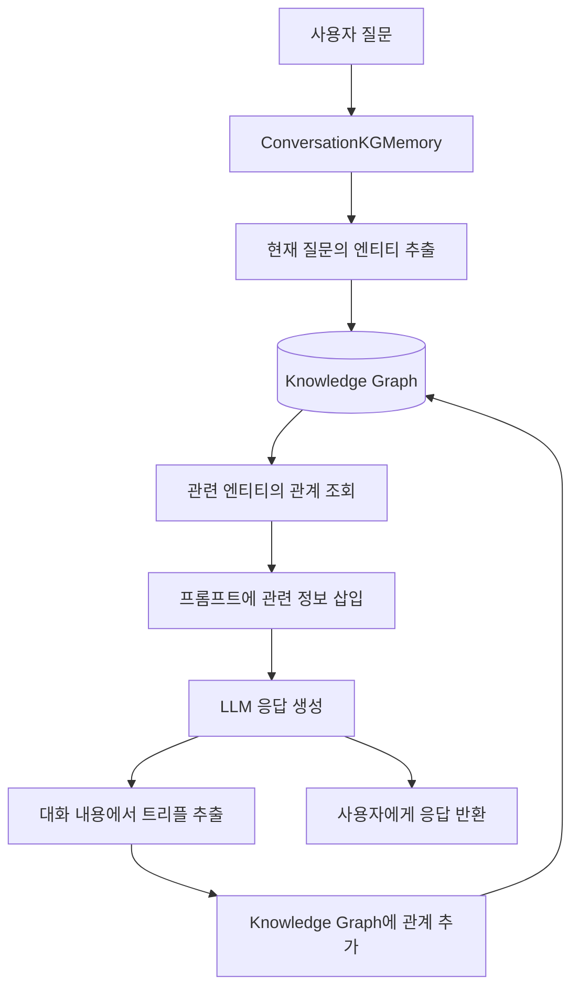

</details>

- 지식 그래프(KG; Knowledge Graph)를 활용하여 정보를 저장하고 불러온다.
- 이를 통해 모델이 서로 다른 개체 간의 관계를 이해하는 데 도움을 주고, 복잡한 연결망과 역사적 맥락을 기반으로 대응하는 능력을 향상시킨다.

## 대화 요약 메모리(ConversationSummaryMemory)
```python
from langchain_classic.memory import ConversationSummaryMemory
from langchain_openai import ChatOpenAI
from langchain_core.prompts import PromptTemplate


# 1. LLM 생성 (요약용)
llm = ChatOpenAI(
    model="gpt-4o-mini",
    temperature=0,
)

# 2. 요약 프롬프트 생성
summary_prompt = PromptTemplate.from_template(
    """
기존 대화 요약:
{summary}

새로운 대화:
{new_lines}

기존 요약에 새로운 대화를 반영하여
중요한 정보를 한국어로 간결하게 요약하세요.

갱신된 요약:
"""
)

# 3. ConversationSummaryMemory 생성
memory = ConversationSummaryMemory(
    llm=llm,
    prompt=summary_prompt,
    memory_key="history",
    return_messages=False,
)

# 4. 첫 번째 대화 저장
memory.save_context(
    {"input": "저는 Atlas 프로젝트를 개발하고 있어요."},
    {"output": "Atlas 프로젝트를 개발하고 계시는군요."},
)

print("=== 첫 번째 대화 저장 후 ===")
print(memory.buffer)


# 5. 두 번째 대화 저장
memory.save_context(
    {"input": "Atlas는 청년 정책 추천 서비스예요."},
    {"output": "청년 정책을 추천하는 서비스군요."},
)

print("\n=== 두 번째 대화 저장 후 ===")
print(memory.buffer)


# 6. 세 번째 대화 저장
memory.save_context(
    {"input": "Atlas의 백엔드는 FastAPI를 사용해요."},
    {"output": "FastAPI로 개발하고 계시는군요."},
)

print("\n=== 세 번째 대화 저장 후 ===")
print(memory.buffer)


# 7. 최종 메모리 조회
print("\n=== 최종 요약 조회 ===")
print(memory.load_memory_variables({}))

# 출력
# === 첫 번째 대화 저장 후 ===
# 사용자는 Atlas 프로젝트를 개발하고 있다.

# === 두 번째 대화 저장 후 ===
# 사용자는 Atlas라는 청년 정책 추천 서비스를 개발하고 있다.

# === 세 번째 대화 저장 후 ===
# 사용자는 Atlas라는 청년 정책 추천 서비스를 개발하고 있으며,
# 백엔드 프레임워크로 FastAPI를 사용한다.

# === 최종 요약 조회 ===
# {
#     'history': '사용자는 Atlas라는 청년 정책 추천 서비스를 개발하고 있으며, 백엔드 프레임워크로 FastAPI를 사용한다.'
# }
```

<details>
<summary>내부 동작 방식 보기</summary>

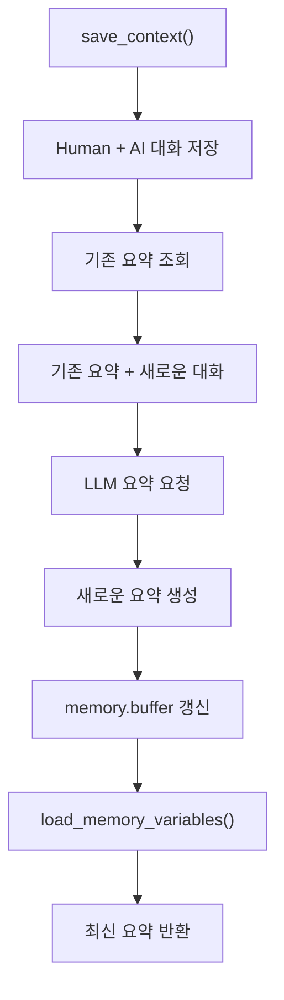

</details>

- 이전 대화의 내용을 원문 텍스트 그대로 보관하지 않고 대화가 진행되는 동안 대화를 요약하고 요약본을 메모리에 저장한다.
- 이 메모리는 과거 메시지 기록을 프롬프트에 그대로 보관하면 토큰을 많이 차지할 수 있는 긴 대화에 가장 유용하다.

## 대화 요약 버퍼 메모리(ConversationSummaryBufferMemory)
```python
from langchain_classic.memory import ConversationSummaryBufferMemory
from langchain_core.prompts import PromptTemplate
from langchain_openai import ChatOpenAI


# 1. LLM 생성
llm = ChatOpenAI(
    model="gpt-4o-mini",
    temperature=0,
)

# 2. 요약 프롬프트
summary_prompt = PromptTemplate.from_template(
    """
기존 대화 요약:
{summary}

새롭게 요약할 대화:
{new_lines}

기존 요약에 새로운 대화 내용을 반영하세요.
중요한 정보를 유지하면서 한국어로 간결하게 요약하세요.

갱신된 요약:
"""
)

# 3. 메모리 생성
memory = ConversationSummaryBufferMemory(
    llm=llm,
    prompt=summary_prompt,
    max_token_limit=100,
    memory_key="history",
    return_messages=True,
)

# 4. 첫 번째 대화 저장
memory.save_context(
    {
        "input": "Atlas라는 청년 정책 추천 서비스를 개발하고 있어요. "
                 "서울 청년들이 적합한 지원 정책을 찾도록 돕는 서비스입니다."
    },
    {
        "output": "Atlas는 청년 정책을 찾아주는 서비스군요."
    },
)

# 5. 두 번째 대화 저장
memory.save_context(
    {
        "input": "사용자의 조건과 정책 공고문을 분석해서 "
                 "신청 자격을 판단하고 필요한 서류도 안내합니다."
    },
    {
        "output": "정책별 자격 검증과 서류 안내 기능을 제공하는군요."
    },
)

# 6. 세 번째 대화 저장
memory.save_context(
    {
        "input": "백엔드는 FastAPI, 데이터베이스는 PostgreSQL을 사용합니다. "
                 "공고문 검색에는 Chroma 기반 RAG를 적용합니다."
    },
    {
        "output": "FastAPI와 PostgreSQL, Chroma 기반 RAG를 사용하시는군요."
    },
)

# 7. 네 번째 대화 저장
memory.save_context(
    {
        "input": "LangGraph로 에이전트를 구성하고, "
                 "자격 판단 결과에 근거 문서와 판단 이유도 제공하려고 합니다."
    },
    {
        "output": "LangGraph를 사용하고 근거 기반 자격 검증을 구현하는군요."
    },
)

# 8. 요약된 대화 확인
print("=== 누적 요약 ===")
print(memory.moving_summary_buffer)

# 9. 원문으로 남은 대화 확인
print("\n=== 최근 대화 원문 ===")
for message in memory.chat_memory.messages:
    print(type(message).__name__, ":", message.content)

# 10. 실제 LLM에 전달할 메모리 조회
print("\n=== 최종 메모리 ===")
history = memory.load_memory_variables({})["history"]

for message in history:
    print(type(message).__name__, ":", message.content)

# 출력
# === 누적 요약 ===
# 사용자는 Atlas라는 서울 청년 대상 정책 추천 서비스를
# 개발 중이다. 사용자 조건과 공고문을 분석해 신청 자격과
# 필요 서류를 안내한다. 백엔드는 FastAPI, DB는
# PostgreSQL이며 Chroma 기반 RAG를 사용한다.

# === 최근 대화 원문 ===
# HumanMessage : LangGraph로 에이전트를 구성하고,
# 자격 판단 결과에 근거 문서와 판단 이유도 제공하려고 합니다.

# AIMessage : LangGraph를 사용하고
# 근거 기반 자격 검증을 구현하는군요.

# === 최종 메모리 ===
# SystemMessage : 사용자는 Atlas라는 서울 청년 대상
# 정책 추천 서비스를 개발 중이다. ...

# HumanMessage : LangGraph로 에이전트를 구성하고, ...

# AIMessage : LangGraph를 사용하고 근거 기반
# 자격 검증을 구현하는군요.
```

<details>
<summary>내부 동작 방식 보기</summary>

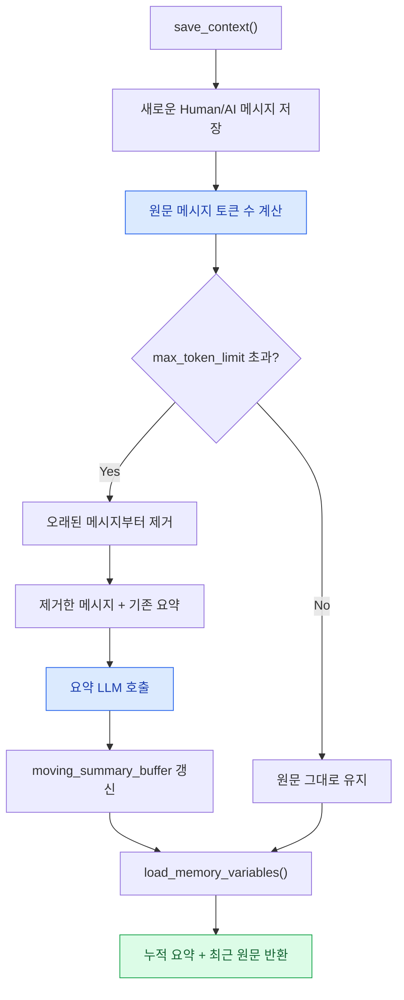

</details>

- 최근 대화 기록과 요약을 결합한 메모리 방식이다.
- 일정 수준까지는 대화의 원본 내용을 그대로 유지하면서 사용자가 최신 대화 맥락을 활용할 수 있도록 한다.
- 대화가 길어져 메모리가 초과되면 이전 대화를 요약하여 저장한다.

## 벡터 스토어 검색 메모리(VectorStoreRetrieverMemory)
```python
import faiss

from langchain_classic.memory import VectorStoreRetrieverMemory
from langchain_community.vectorstores import FAISS
from langchain_community.docstore.in_memory import InMemoryDocstore
from langchain_openai import OpenAIEmbeddings


# 1. 임베딩 모델 생성
embeddings = OpenAIEmbeddings()

# 2. FAISS 인덱스 생성 (1536차원)
embedding_size = 1536
index = faiss.IndexFlatL2(embedding_size)

# 3. FAISS 벡터 저장소 생성
vectorstore = FAISS(
    embedding_function=embeddings,
    index=index,
    docstore=InMemoryDocstore({}),
    index_to_docstore_id={},
)

# 4. Retriever 생성
retriever = vectorstore.as_retriever(
    search_type="similarity",
    search_kwargs={"k": 1},
)

# 5. VectorStoreRetrieverMemory 생성
memory = VectorStoreRetrieverMemory(
    retriever=retriever,
    memory_key="history",
    input_key="input",
    return_docs=False,
)

# 6. 첫 번째 대화 저장
memory.save_context(
    {"input": "Atlas 프로젝트는 PostgreSQL을 사용합니다."},
    {"output": "PostgreSQL을 데이터베이스로 사용하시는군요."},
)

# 7. 두 번째 대화 저장
memory.save_context(
    {"input": "저는 주말에 축구하는 것을 좋아합니다."},
    {"output": "축구를 즐겨 하시는군요."},
)

# 8. 세 번째 대화 저장
memory.save_context(
    {"input": "오늘은 날씨가 정말 좋네요."},
    {"output": "야외 활동하기 좋은 날씨군요."},
)

# 9. FAISS에 저장된 벡터 수 확인
print("저장된 벡터 수:", vectorstore.index.ntotal)

# 10. 관련된 과거 대화 검색
result = memory.load_memory_variables({
    "input": "Atlas 프로젝트에서 사용하는 데이터베이스는 뭐였지?"
})

print("\n=== 검색된 대화 기록 ===")
print(result["history"])

# 출력
# 저장된 벡터 수: 3

# === 검색된 대화 기록 ===
# input: Atlas 프로젝트는 PostgreSQL을 사용합니다.
# output: PostgreSQL을 데이터베이스로 사용하시는군요.
```

<details>
<summary>내부 동작 방식 보기</summary>

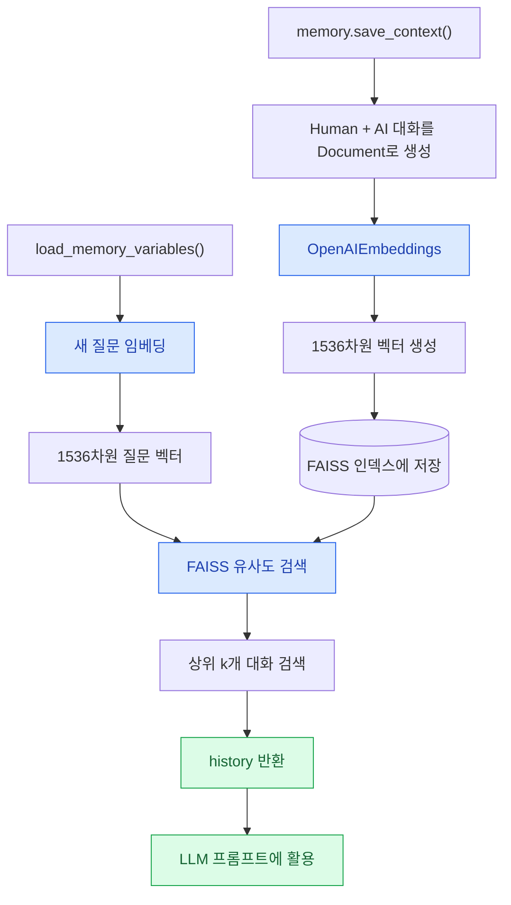

</details>

- 대화 내용을 벡터 스토어(vector store) 데이터베이스에 저장하고 조회해 볼 수 있는 기능이다.
- 벡터 스토어에 저장된 과거 대화 기록 중에서 쿼리 내용과 가장 비슷한 상위 k개의 문서를 조회한다.
- 다른 메모리에서는 대화 기록을 시간 순서에 따라 저장하는 데 반해 시간 순서를 고려하지 않고 과거 대화 내용을 검색해서 필요한 내용을 뽑아낸다는 특징이 있다.
- 대화가 오래되거나 축적된 정보가 많을 때도 유용하다.

## LCEL 체인에 메모리 추가하기
```python
from operator import itemgetter

from langchain_classic.memory import ConversationBufferMemory
from langchain_core.prompts import ChatPromptTemplate, MessagesPlaceholder
from langchain_core.runnables import RunnableLambda, RunnablePassthrough
from langchain_core.output_parsers import StrOutputParser
from langchain_openai import ChatOpenAI


# 1. LLM 생성
llm = ChatOpenAI(
    model="gpt-4o-mini",
    temperature=0,
)

# 2. 메모리 생성
memory = ConversationBufferMemory(
    memory_key="chat_history",
    input_key="input",
    output_key="output",
    return_messages=True,
)

# 3. 프롬프트 생성
prompt = ChatPromptTemplate.from_messages([
    ("system", "당신은 이전 대화를 기억하는 친절한 AI입니다."),
    MessagesPlaceholder(variable_name="chat_history"),
    ("human", "{input}"),
])

# 4. 메모리 조회 및 대화 기록 전달
history_loader = RunnablePassthrough.assign(
    chat_history=(
        RunnableLambda(memory.load_memory_variables)
        | itemgetter("chat_history")
    )
)

# 5. 응답 저장 함수
def save_and_return(data: dict) -> str:
    memory.save_context(
        {"input": data["input"]},
        {"output": data["output"]},
    )
    return data["output"]


# 6. LCEL 체인 구성
chain = (
    history_loader
    | RunnablePassthrough.assign(
        output=prompt | llm | StrOutputParser()
    )
    | RunnableLambda(save_and_return)
)

# 7. 첫 번째 대화
response1 = chain.invoke({
    "input": "내가 좋아하는 프로그래밍 언어는 Kotlin이야."
})
print("AI:", response1)

# 8. 두 번째 대화
response2 = chain.invoke({
    "input": "내가 좋아하는 프로그래밍 언어가 뭐였지?"
})
print("AI:", response2)

# 9. 메모리 조회
print("\n=== 저장된 대화 ===")

history = memory.load_memory_variables({})["chat_history"]

for message in history:
    print(type(message).__name__, ":", message.content)

# 출력
# AI: Kotlin을 좋아하시는군요!

# AI: 좋아하는 프로그래밍 언어는 Kotlin이라고 말씀하셨어요.

# === 저장된 대화 ===
# HumanMessage : 내가 좋아하는 프로그래밍 언어는 Kotlin이야.
# AIMessage : Kotlin을 좋아하시는군요!
# HumanMessage : 내가 좋아하는 프로그래밍 언어가 뭐였지?
# AIMessage : 좋아하는 프로그래밍 언어는 Kotlin이라고 말씀하셨어요.
```

<details>
<summary>내부 동작 방식 보기</summary>

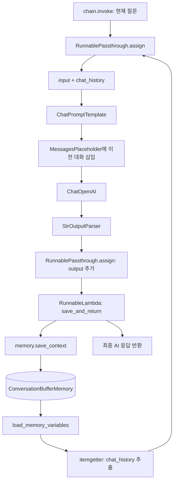

</details>

- LCEL은 `|` 연산자로 **대화 기록 조회 → 프롬프트 구성 → 모델 호출 → 응답 변환 → 대화 저장** 단계를 연결한다.
- 이전 대화 기록을 현재 질문에 추가하고, `MessagesPlaceholder`를 통해 프롬프트에 삽입한다. 메모리의 키와 프롬프트 변수 이름은 같아야 한다.
- 모델은 이전 대화와 현재 질문을 바탕으로 응답을 생성한다. 질문과 응답을 메모리에 저장한 뒤 최종 응답을 반환한다.
- 메모리 조회·저장은 체인에 명시적으로 연결해야 하며, 다음 요청에서도 같은 대화의 메모리를 사용한다.


## SQLite에 대화 내용 저장하기
```python
from sqlalchemy import create_engine

from langchain_community.chat_message_histories import SQLChatMessageHistory
from langchain_core.prompts import ChatPromptTemplate, MessagesPlaceholder
from langchain_core.output_parsers import StrOutputParser
from langchain_core.runnables import ConfigurableFieldSpec
from langchain_core.runnables.history import RunnableWithMessageHistory
from langchain_openai import ChatOpenAI


# 1. SQLite 연결
engine = create_engine("sqlite:///chat_history.db")


# 2. 사용자 및 대화방별 메시지 저장소 반환
def get_session_history(
    user_id: str,
    conversation_id: str,
) -> SQLChatMessageHistory:
    return SQLChatMessageHistory(
        session_id=f"{user_id}:{conversation_id}",
        connection=engine,
    )


# 3. 프롬프트 생성
prompt = ChatPromptTemplate.from_messages([
    ("system", "당신은 이전 대화를 기억하는 AI입니다."),
    MessagesPlaceholder("chat_history"),
    ("human", "{question}"),
])


# 4. LLM 생성
llm = ChatOpenAI(
    model="gpt-4o-mini",
    temperature=0,
)


# 5. LCEL 체인
chain = prompt | llm | StrOutputParser()


# 6. 대화 기록 관리 기능 연결
chain_with_history = RunnableWithMessageHistory(
    runnable=chain,
    get_session_history=get_session_history,
    input_messages_key="question",
    history_messages_key="chat_history",
    history_factory_config=[
        ConfigurableFieldSpec(
            id="user_id",
            annotation=str,
            name="User ID",
            description="사용자 고유 식별자",
            is_shared=True,
        ),
        ConfigurableFieldSpec(
            id="conversation_id",
            annotation=str,
            name="Conversation ID",
            description="대화방 고유 식별자",
            is_shared=True,
        ),
    ],
)


# 7. 첫 번째 대화
config = {
    "configurable": {
        "user_id": "user-001",
        "conversation_id": "chat-001",
    }
}

response1 = chain_with_history.invoke(
    {"question": "내 이름은 이안이고 백엔드 개발자야."},
    config=config,
)

print("AI:", response1)


# 8. 두 번째 대화 - 동일한 대화방
response2 = chain_with_history.invoke(
    {"question": "내 이름과 직업이 뭐였지?"},
    config=config,
)

print("AI:", response2)


# 9. 다른 대화방에서 질문
response3 = chain_with_history.invoke(
    {"question": "내 이름이 뭐였지?"},
    config={
        "configurable": {
            "user_id": "user-001",
            "conversation_id": "chat-002",
        }
    },
)

print("다른 대화방 AI:", response3)


# 10. 첫 번째 대화방 기록 확인
history = get_session_history("user-001", "chat-001")

print("\n=== chat-001 대화 기록 ===")

for message in history.messages:
    print(type(message).__name__, ":", message.content)

# 출력
# AI: 반가워요! 백엔드 개발자시군요.

# AI: 이름은 이안이고, 백엔드 개발자라고 말씀하셨어요.

# 다른 대화방 AI: 아직 이름을 알려주시지 않았어요.

# === chat-001 대화 기록 ===
# HumanMessage : 내 이름은 이안이고 백엔드 개발자야.
# AIMessage : 반가워요! 백엔드 개발자시군요.
# HumanMessage : 내 이름과 직업이 뭐였지?
# AIMessage : 이름은 이안이고, 백엔드 개발자라고 말씀하셨어요.
```

<details>
<summary>내부 동작 방식 보기</summary>

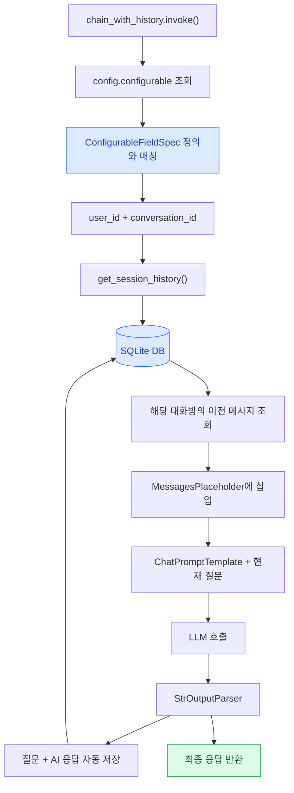

</details>

- SQLite 파일에 대화 기록을 저장하여 프로그램을 재시작해도 같은 대화를 이어 갈 수 있다.
- `config.configurable`의 `user_id`와 `conversation_id`를 `ConfigurableFieldSpec` 정의에 맞춰 전달하고, 두 값으로 사용자·대화방별 기록을 구분한다.
- `RunnableWithMessageHistory`가 이전 메시지를 조회해 프롬프트에 삽입하고, 응답 생성 후 현재 질문과 AI 응답을 자동으로 저장한다.
- 같은 사용자·대화방 식별자를 전달하면 기존 기록을 활용하고, 다른 식별자를 전달하면 별도의 대화로 처리한다.

## 휘발성 메모리로 일반 변수에 대화 내용 저장하기
```python
from langchain_core.chat_history import InMemoryChatMessageHistory
from langchain_core.prompts import ChatPromptTemplate, MessagesPlaceholder
from langchain_core.runnables.history import RunnableWithMessageHistory
from langchain_core.output_parsers import StrOutputParser
from langchain_openai import ChatOpenAI


# 1. 대화 기록을 보관할 일반 변수
store = {}


# 2. 세션별 대화 기록 반환 함수
def get_session_history(session_id: str):
    if session_id not in store:
        store[session_id] = InMemoryChatMessageHistory()

    return store[session_id]


# 3. LLM 생성
llm = ChatOpenAI(
    model="gpt-4o-mini",
    temperature=0,
)


# 4. 프롬프트 생성
prompt = ChatPromptTemplate.from_messages([
    ("system", "당신은 이전 대화를 기억하는 친절한 AI입니다."),
    MessagesPlaceholder(variable_name="chat_history"),
    ("human", "{question}"),
])


# 5. LCEL 체인 생성
chain = prompt | llm | StrOutputParser()


# 6. RunnableWithMessageHistory 연결
chain_with_history = RunnableWithMessageHistory(
    runnable=chain,
    get_session_history=get_session_history,
    input_messages_key="question",
    history_messages_key="chat_history",
)


# 7. 세션 설정
config = {
    "configurable": {
        "session_id": "user-001"
    }
}


# 8. 첫 번째 대화
response1 = chain_with_history.invoke(
    {"question": "내 이름은 이안이고, 백엔드 개발자야."},
    config=config,
)
print("AI:", response1)


# 9. 두 번째 대화
response2 = chain_with_history.invoke(
    {"question": "내 이름과 직업이 뭐였지?"},
    config=config,
)
print("AI:", response2)


# 10. 저장된 대화 기록 확인
print("\n=== 저장된 대화 기록 ===")

history = store["user-001"]

for message in history.messages:
    print(type(message).__name__, ":", message.content)

# 출력

# AI: 반가워요! 백엔드 개발자이시군요.

# AI: 이름은 이안이고, 백엔드 개발자라고 말씀하셨어요.

# === 저장된 대화 기록 ===
# HumanMessage : 내 이름은 이안이고, 백엔드 개발자야.
# AIMessage : 반가워요! 백엔드 개발자이시군요.
# HumanMessage : 내 이름과 직업이 뭐였지?
# AIMessage : 이름은 이안이고, 백엔드 개발자라고 말씀하셨어요.
```

<details>
<summary>내부 동작 방식 보기</summary>

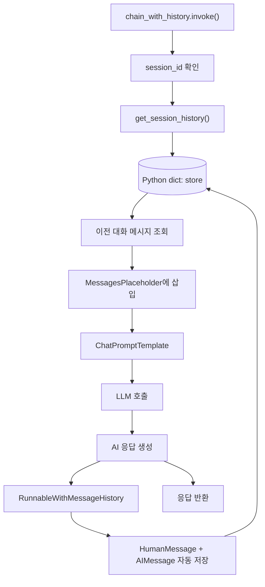

</details>

- 파이썬 딕셔너리 `store`에 `session_id`별 메시지 기록을 보관한다. `get_session_history()`는 해당 세션의 기록을 반환하고, 처음 사용하는 세션이면 새 기록을 생성한다.
- `RunnableWithMessageHistory`가 이전 메시지를 프롬프트에 삽입하고, 응답 생성 후 질문과 AI 응답을 자동으로 저장한다.
- 같은 `session_id`와 저장소를 사용하면 대화를 이어 가며, 다른 세션의 기록은 분리한다.
- 기록은 실행 중인 프로세스의 메모리에만 존재하므로 프로그램을 종료하면 사라지고, 다른 프로세스와 자동으로 공유되지 않는다.

## LangGraph를 활용한 메모리 구현
### LangGraph로 대체해서 구현하는 메모리 기능
| 기존 LangChain 기능 | LangGraph에서의 구현 방식 |
|---|---|
| ConversationBufferMemory | MessagesState + Checkpointer |
| ConversationBufferWindowMemory | MessagesState + 최근 N개 메시지 선택 |
| ConversationTokenBufferMemory | trim_messages() + 토큰 제한 |
| ConversationSummaryMemory | State의 summary + 요약 노드 |
| ConversationSummaryBufferMemory | 요약 노드 + 최근 메시지 유지 |
| ConversationEntityMemory | Store + 엔티티 추출·갱신 노드 |
| ConversationKGMemory | 그래프 저장소 + 관계 추출·조회 노드 |
| VectorStoreRetrieverMemory | Vector Store + 검색 노드 + State |

### 대화 기록 자동 연결 및 저장 기능
| 기존 방식 | LangGraph에서의 구현 방식 |
|---|---|
| RunnableWithMessageHistory | MessagesState + Checkpointer |
| SQLChatMessageHistory 기반 대화 저장 | DB 기반 Checkpointer |
| InMemoryChatMessageHistory 기반 대화 저장 | InMemorySaver |
| RunnablePassthrough.assign()을 이용한 메모리 주입 | Node에서 State 읽기 |
| save_context() / load_memory_variables() | State 업데이트 및 Checkpointer 복원 |
